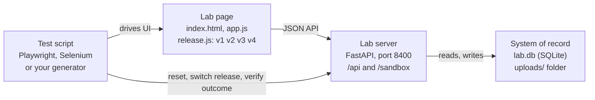

# Harbor Mutual Automation Lab — Knowledge Base

As of 2026-11-09 · Shan Konduru · Companion files: [requirements](automation-lab-requirements.csv), [test cases](automation-lab-test-cases.csv)

## Overview

The Harbor Mutual Automation Lab is a no-login web application built as a target for UI test automation: script generation, script execution and self-healing. It belongs to the fictitious insurer Harbor Mutual, uses no real customer data and needs no LLM. It lives in the `SystemsUnderTest` repository in `automation-lab/`, next to the chat assistant, the claims agent and the member desk.

Every area of the lab exercises a different kind of control that a generated script must drive. Every meaningful action is recorded on the server, so a test run can be checked against the system of record (the API and `lab.db`), not only against what the screen shows.

| Item | Value |
| --- | --- |
| URL (Docker) | http://127.0.0.1:8400 (bound to localhost only) |
| Login | None |
| Stack | FastAPI + SQLite; plain HTML, CSS and JavaScript page (no build step) |
| Data | `automation-lab/data/lab.db` and `automation-lab/data/uploads/` (git-ignored) |
| Fixed "today" | 2026-11-03 (`LAB_TODAY`), so dates and validation are reproducible |
| Image | `ghcr.io/<owner>/harbor-automation-lab`, tags `sha-<commit>` and `latest` |
| Audience | Test engineers, TruAssure pilots, demos of script generation and self-healing |



A script drives the page in a browser; the page talks only to the lab server's JSON API, which writes the system of record. The same script resets data, switches the release and verifies outcomes through the API.

### Run it

1. From the repository root: `docker compose -f automation-lab/docker-compose.yml up -d --build`
2. Open http://127.0.0.1:8400. Add `?release=v2` or `?release=v3` for the changed UI releases.
3. Stop with `docker compose -f automation-lab/docker-compose.yml down`. Data stays in `automation-lab/data/`.

For local development: create a Python 3.12 virtual environment in `automation-lab/`, install `requirements.txt` plus `pytest pytest-cov httpx ruff`, then run `uvicorn automation_lab.app:app --reload --port 8400`. The offline test suite is `python -m pytest -q --cov` (47 tests, 95% coverage gate).

## Shell and navigation

The lab is a single-page app: one header, a left navigation and nine pages switched by the URL hash (`#/quote`, `#/claim` and so on). An unknown or empty hash opens the Overview.

| Element | Behaviour |
| --- | --- |
| Brand link | "Harbor Mutual" with an orange "Automation Lab" tag; goes to `#/overview`. |
| UI release picker | A select labelled "UI release" with v1 Baseline, v2 Redesign, v3 Dynamic and v4 Structural. Changing it reloads the page with `?release=<value>`, keeping the current hash. |
| Release banner | On v2, v3 and v4 an orange banner under the header names the release and what it changes; with live drift on it also says how often elements are renamed. Hidden on v1 without drift. |
| Activity link and badge | "Activity" with an orange count of activity events known to the page; goes to `#/activity`. The count refreshes after every recorded action. |
| Left navigation | Groups: Workflows (Get a quote, File a claim), Controls (Documents & uploads, Drag & drop, Policies table, Interactions, Waits & dynamic content), Results (Activity log). The current page's link has `aria-current="page"`. |
| Page title | The browser tab reads "\<Page name> · Harbor Mutual Automation Lab". |
| Mobile navigation | Under 760 px wide the navigation hides behind a ☰ button ("Open navigation", `aria-expanded`). Choosing a page closes it. |
| Theme | Navy `#26357f` and orange `#f08a1c`, the chat assistant's palette. Follows the system's light or dark mode. |
| Toasts | Notifications at the bottom right. They close after 4 seconds (6 for upload rejections) or with ×. Success is green, errors are red. |
| Modal dialog | One shared dialog (`role="dialog"`, `aria-modal`). Escape or a click on the backdrop closes it; Tab cycles inside it; focus returns to the opener. |

Pages that are not shown stay in the DOM, hidden. A label such as "Email" therefore exists on more than one page; scripts should scope locators to the visible page region (each page is a `region` named after its heading).

The Overview page holds a hero with "Start with a quote" and "See the activity log", one card per area with the controls it exercises, and a table of what each UI release changes.

## Get a quote (`#/quote`)

The quote form prices a new policy on the server and saves it under a reference `Q-2026-NNNN` (numbered from 0001 after a reset). The page validates fields when they lose focus and again on submit; the server repeats every check and answers 422 with field errors if one fails.

### Fields

| Section | Label (accessible name) | Control | Rule | Error message |
| --- | --- | --- | --- | --- |
| Coverage | Product | Select: Auto, Home, Renters, Boat, Term life | Required | Choose a product. |
| Coverage | Coverage start date | Date input (min today, max today + 90) | Required; from today to today + 90 days, i.e. 2026-11-03 to 2027-02-01 inclusive | Choose a coverage start date. / Coverage must start within the next 90 days. |
| Coverage | Coverage level | Segmented radio: Basic, Standard (default), Premium | Required | Choose a coverage level. |
| Coverage | Deductible | Range 0–2 mapped to $500, $1,000 (default), $2,500; output shows the amount; `aria-valuetext` = amount | Must be 500, 1000 or 2500 (server) | Choose a deductible of 500, 1000 or 2500. |
| Coverage | Add-ons | Checkboxes: Roadside assistance (+$48), Rental car (+$72), Glass cover (+$36), Flood (+$210), Jewelry rider (+$95) | Disabled and cleared when not offered for the product | Some add-ons aren't available for \<Product>. (server) |
| Your vehicle (Auto only) | Vehicle make | Combobox; suggestions appear 250 ms after typing, up to 8, substring match | Optional | — |
| Your vehicle | Model year | Number 1990–2027 | Optional | — |
| Your vehicle | Annual mileage | Select, default 5,000 – 10,000 | Optional | — |
| Your property (Home, Renters) | Property type; Square feet | Select; number 200–20000 | Optional | — |
| Your boat (Boat only) | Length (feet); Hull | Number 8–80; radio Fiberglass (default), Aluminum, Wood | Optional | — |
| About you | First name; Last name | Text, max 40 characters | Required, ≤ 40 | Enter your first name. / Enter your last name. (server: Your first name can be at most 40 characters.) |
| About you | Date of birth | Date (max today) | Required; age 18–100 on 2026-11-03 | Enter your date of birth. / You must be between 18 and 100 years old. |
| About you | Email | Email input | Required; `x@y.zz` shape | Enter a valid email address. |
| About you | Phone (optional) | Tel input | Optional; 10 digits as `(555) 010-2030`, `555-010-2030`, `555.010.2030` or `5550102030` | Enter a 10-digit phone number. |
| About you | ZIP code | Text, 5 characters | Required; exactly 5 digits | Enter a 5-digit ZIP code. |
| Billing | Payment plan | Radio: Pay yearly (default), Pay monthly (+4%) | Required | Choose a payment plan. |
| Billing | Paperless billing (−3%) | `role="switch"`; click, Space or Enter toggles `aria-checked` | Optional | — |
| Billing | I have another Harbor Mutual policy (−10%) | Checkbox | Optional | — |
| Billing | Anything else we should know? | Textarea, max 500; counter "N / 500" | ≤ 500 (server) | Notes can be at most 500 characters. |
| Billing | I agree that Harbor Mutual may contact me about this quote. | Checkbox | Must be ticked | You must agree to be contacted about this quote. |

Add-on availability: Roadside and Rental — Auto; Glass — Auto, Boat; Flood — Home, Renters, Boat; Jewelry — Home, Renters; Term life — none. With no product chosen, all add-ons are enabled.

The vehicle make combobox supports ↓/↑ to highlight (`aria-activedescendant`), Enter to choose, Escape to close, mouse click to choose; "No matching make" shows when nothing matches. Choosing a product shows only its section (Auto → Your vehicle; Home or Renters → Your property; Boat → Your boat; Term life → none).

### Submitting

1. **Get my quote** validates every field. On errors a red alert at the top says "Please correct N field(s) before we can price your quote.", each field shows its message, invalid inputs get `aria-invalid="true"` and focus moves to the first invalid field.
2. When valid, the button disables, the result panel shows "Pricing your policy…" with a spinner, and the page posts to `POST /api/quotes`.
3. The result appears at least 0.8 seconds after submit (8 seconds with the `slow_ui` defect).
4. **Start over** resets the form, errors, product sections, switch, notes counter and the result panel.

### Pricing

```latex
\text{core} = \text{base} \times \text{coverage} \times \text{deductible} \times \text{age}
```

| Factor | Values |
| --- | --- |
| Base premium | Auto $620, Home $940, Renters $180, Boat $410, Term life $300 |
| Coverage | Basic 0.85, Standard 1.00, Premium 1.30 |
| Deductible | $500 → 1.10, $1,000 → 1.00, $2,500 → 0.88 |
| Age on 2026-11-03 | under 25 → 1.35; over 65 → 1.15; otherwise 1.00 |

Then, in order: add each add-on's price; subtract 10% (rounded to cents) if "another policy" is ticked; subtract 3% of the remainder if paperless is on. The result, rounded to cents, is the annual premium. Monthly plan: monthly payment = annual × 1.04 ÷ 12, rounded to cents, and a "Monthly payment plan (4%)" line is added.

Worked example: Auto, Standard, $1,000, born 1990-05-01, Roadside, another policy, paperless, yearly → 620 + 48 = 668 → −66.80 = 601.20 → −18.04 = **$583.16 / year**. Monthly plan: **$50.54** a month.

### Result panel

- Quote reference (`Q-2026-NNNN`), the premium as "$583.16 / year", and "Paid once a year" or "or $50.54 a month".
- A breakdown table: base premium, "Coverage, deductible and age adjustments", each add-on, discounts as negative amounts, the monthly surcharge, then "Annual premium".
- "Multi-policy discount of 10% applied." under the table when the box was ticked (still shown under the `discount_ignored` defect — that is the bug).
- **Download quote** saves `<quote id>.json` (the quote and the request). **File a claim instead** goes to the wizard.
- The server logs a `quote` activity: "Quote Q-2026-0001: Auto, $583.16/year".

## File a claim (`#/claim`)

The claim wizard files a claim in four steps and returns a claim number `CLM-9NNN` (CLM-9001 first after a reset). Each step is checked before **Next** moves on; the server checks everything again on submit.

The stepper above the form lists the four steps; the current one has `aria-current="step"`, finished ones show a green number. **Back** is disabled on step 1, **Next** is hidden on step 4, and **Submit claim** shows only on step 4. On errors a red alert says "Please correct N field(s) on this step." and focus moves to the first invalid field.

### Step 1 — Policy & incident

| Label | Control | Rule | Error message |
| --- | --- | --- | --- |
| Policy number | Text with a datalist of every active policy ("Holder · Product") | Must exist and be active; lowercase is accepted | We couldn't find that policy number. / Policy POL-1002 is lapsed; claims need an active policy. |
| What happened? | Select: Collision, Theft or break-in, Water damage, Fire or smoke, Storm or hail, Something else | Required | Choose what happened. |
| Date of incident | Date (min 2025-11-03, max 2026-11-03) | Within the last 365 days, not in the future | Enter the date of the incident. / The incident must be within the last 12 months and not in the future. |
| Approximate time (optional) | Time input | Optional | — |
| Where did it happen? | Text | Required | Enter where it happened. |

Typing a full policy number (`POL-` + 4 digits) looks it up 300 ms later and shows "Policyholder: Shan Mercer · Auto · Active", or "No policy POL-9999 was found.". Anything not in that shape hides the note.

### Step 2 — What happened

| Label | Control | Rule | Error message |
| --- | --- | --- | --- |
| Describe what happened | Textarea, max 2000; counter "N / 2000 (at least 20)" | 20–2000 characters after trimming | Describe what happened in 20 to 2000 characters. |
| Was a police report filed? | Radio Yes / No (default No) | — | — |
| Police report number | Text, shown only when Yes | Required when Yes | Enter the police report number. |
| Estimated damage (USD) | Number, step 0.01 | Greater than 0 and at most 1,000,000 | Enter an estimate between $1 and $1,000,000. |
| Someone was injured | Checkbox | Optional | — |
| How should we contact you? | Radio Email (default), Phone call, Text message | Required | Choose how we should contact you. |
| Days you're available | Multi-select Monday–Saturday (Ctrl/⌘-click) | Optional | — |

The estimate rule accepts any amount above 0 (for example $0.50), although the message says $1. Test it as written: 0 fails, 0.01 passes.

### Step 3 — Documents (optional)

- **Attach files**: a file input (multiple; accepts .pdf, .png, .jpg, .jpeg, .txt, .csv). Files upload at once to the `claim` area.
- **…or drop files here**: a drop zone (`role="button"`); click, Enter or Space opens the file picker.
- Each attached file is listed with its upload id (`UPL-NNNN`) and a **Remove** button ("Remove \<name>"), which detaches it from the claim only.
- Rejected files raise a red toast "\<name>: \<reason>". **Next** is disabled while an upload runs.

### Step 4 — Review & sign

- A review list: Policy, Policyholder, What happened, When (date and time), Where, Description (first 140 characters, then …), Police report ("Yes, \<number>" or "No"), Estimate, Injuries, Contact by, Available ("Any day" when none), Documents ("None" when none).
- **Sign by typing the policyholder's full name**: must equal the holder's name, ignoring case and extra spaces. Error: "Type the policyholder's full name exactly as shown to sign."
- **The information I've given is true and complete.** must be ticked. Error: "You must confirm the information is true."

### After submitting

- Success: the steps, stepper and buttons hide; a green panel "Claim received" reads "Your claim number is CLM-9001. An adjuster will contact you within two business days."
- **File another claim** clears the form, attachments and errors and returns to step 1.
- A server rejection (422) jumps to the earliest step with an error and shows the server's messages there.
- The server stores the claim (`GET /api/claims`) with the policy number upper-cased and logs "Claim CLM-9001 filed on POL-1001". Under the `phantom_claim` defect the number is returned and logged, but nothing is stored.

## Documents & uploads (`#/documents`)

Three upload paths send files to one store; every stored file gets a reference `UPL-NNNN` and appears in the Uploaded files table. The same rules apply to all of them, the claim wizard included.

### Upload rules (server)

| Rule | Outcome |
| --- | --- |
| Allowed extensions | .pdf, .png, .jpg, .jpeg, .txt, .csv (case-insensitive) |
| Other extension | Rejected: "<.ext> isn't allowed" ("This file type isn't allowed" with no extension) |
| Empty file (0 bytes) | Rejected: "The file is empty" |
| Larger than the limit (default 5 MB, `LAB_MAX_UPLOAD_MB`) | Rejected: "The file is larger than 5 MB"; a file of exactly the limit is accepted |
| File name | Folders are stripped; characters other than letters, digits, `. _ -` and space become `_` (`../../evil?.jpg` → `evil_.jpg`) |
| Mixed batch | Good files are stored, bad ones are listed as rejected with a reason; the request still succeeds (201) |
| Unknown area | 400 (areas: documents, dropzone, photo, claim) |

### Standard file input

- **Files**: a visible `<input type="file" multiple>` with no type filter, so disallowed files can be picked and the server rejection seen.
- **Category**: Proof of identity, Repair estimate, Photo, Other (default). Display only; it is not sent.
- **Upload** is disabled until a file is chosen; the status then reads "2 files selected".
- After upload the status reads "Uploaded 1 file, 1 rejected" (or "Uploaded 2 files"); a green toast lists the stored names; each rejection gets a red toast; the form resets.

### Drag & drop zone

- A drop zone (`role="button"`, name "Drop files here, or press Enter to browse") that highlights while files are dragged over it.
- Dropping uploads at once (area `dropzone`) with a progress bar (`role="progressbar"`, "Upload progress", `aria-valuenow` 0–100) that hides 0.8 s after finishing.
- Results list, newest first: "✓ notes.txt uploaded as UPL-0004" or "✗ bad.exe: .exe isn't allowed".
- Click, Enter or Space opens a hidden file picker that uploads the same way. Files dropped anywhere else on the page are ignored (the browser does not navigate away).

### Styled picker with preview

- **Choose a photo** opens a hidden input that accepts PNG and JPEG.
- The chosen image previews (alt "Selected photo preview") with "name · size"; **Upload photo** stores it (area `photo`) and toasts "Photo uploaded as UPL-0005"; **Clear** removes the selection.

### Uploaded files table

| Column | Content |
| --- | --- |
| Reference | `UPL-NNNN` |
| Name | Stored (cleaned) file name |
| From | Documents, Dropzone, Photo or Claim |
| Size | B, KB or MB with one decimal |
| Uploaded | UTC date and time |
| Actions | **Download** ("Download \<name>", saves the original bytes) and **Delete** |

- Newest first; "No files yet." when empty; **Refresh** reloads it, and it reloads whenever the page opens.
- **Delete** turns into "Delete this file? **Yes, delete** / **Keep**". Yes deletes the file, toasts "Deleted \<name>" and refreshes; Keep restores the buttons.
- **Download policy list (CSV)** saves `harbor-mutual-policies.csv` with all 57 policies.
- The server logs "Uploaded N file(s) to \<area>" and "Deleted upload UPL-NNNN". Under `upload_drops_last`, a multi-file upload reports every file but does not store the last one.

## Drag & drop (`#/board`)

The Drag & drop page has four controls: a claims board that uses native HTML5 drag and drop and saves moves on the server, plus a sortable list, a slider and a signature pad that use pointer events and need real mouse movement.

### Claims board

Four lanes (`role="list"`, named New, In review, Approved, Paid) with a card count each. Seed state:

| Lane | Cards (id · holder · type · amount) |
| --- | --- |
| New | CLM-5002 · Avery Collins · Water · $1,850; CLM-5003 · Indu Varma · Theft · $960; CLM-5006 · Morgan Ellis · Collision · $2,100 |
| In review | CLM-5004 · Jordan Blake · Weather · $7,300; CLM-5005 · Sri Nair · Fire · $15,400; CLM-5009 · Taylor Brooks · Theft · $2,750 |
| Approved | CLM-5001 · Shan Mercer · Collision · $4,200; CLM-5008 · Casey Novak · Other · $300 |
| Paid | CLM-5007 · Riley Chen · Water · $640; CLM-5010 · Quinn Harper · Weather · $5,120 |

- Each card is `role="listitem"` named "CLM-5002, Avery Collins, $1,850.00" and is draggable.
- Dropping a card on a lane places it above the first card whose middle is below the pointer (or last). The lane highlights while a card is over it.
- **◀** and **▶** ("Move CLM-5002 left/right") move a card to the end of the neighbouring lane; at the first or last lane they do nothing.
- After a move the status reads "Moved CLM-5003 from New to In review", lane counts update and the server stores the column and position (`PUT /api/board/cards/{id}`) and logs it.
- If the server refuses a move, a red toast "Couldn't move the card: …" appears and the board reloads from the server.
- The board reloads from the server every time the page opens, so a reload proves the move was saved. Under `board_not_saved` the move reports success but a reload puts the card back.

### Rank your priorities (sortable list)

- Five rows, in order: Review water damage claims, Call back new customers, Approve pending renewals, Audit large payments, Update storm guidance.
- Each row has a rank number and a handle button "Reorder \<row>" (⠿). Press on the handle, move the pointer up or down, release.
- Keyboard: focus a handle, ↑ moves the row up, ↓ down (nothing at the ends).
- The status shows the order, e.g. "Order: 1. Audit large payments · 2. Review water damage claims · …", and a page event "Priorities reordered" is logged. The order is not saved; a reload restores the default.

### Coverage limit (custom slider)

- `role="slider"` named "Coverage limit": min $50,000, max $1,000,000, step $10,000, default $300,000; `aria-valuenow` and `aria-valuetext` follow the value.
- Drag the thumb or press anywhere on the track; values snap to $10,000 and stay within the range.
- Keys: →/↑ +$10,000, ←/↓ −$10,000, Page Up +$100,000, Page Down −$100,000, Home minimum, End maximum.
- Releasing the pointer or pressing a key logs "Coverage limit set to $1,000,000".

### Signature pad

- A canvas named "Signature pad". Drawing with the mouse or a finger leaves a line; the status changes from "Not signed" to "Signed: 1 stroke, 23 points".
- Each finished stroke logs "Signature drawn (S strokes, P points)". **Clear** wipes the canvas and resets the status to "Not signed".

## Policies table (`#/policies`)

The policies table lists the 57 seed policies with search, filters, sorting and paging done on the server, each after a 300 ms network wait (`LAB_LATENCY_MS`). It opens on page 1, 10 rows, sorted by policy number ascending: "Showing 1–10 of 57 policies".

### Toolbar

| Control | Behaviour |
| --- | --- |
| Search (searchbox, placeholder "Policy number or name") | Case-insensitive substring of the policy number or holder. Runs 400 ms after typing stops, or at once with the **Search** button or Enter. |
| Status | Any status (default), Active, Pending, Lapsed, Cancelled |
| Products | Checkboxes Auto, Home, Renters, Boat, Life; none ticked = all products; several = any of them |
| Rows per page | 5, 10 (default), 25 |

Any search, filter or page-size change returns to page 1. Filters combine (AND).

### Table

- Columns: select checkbox, Policy (a button that opens details), Policyholder, Product, Status (coloured pill), Premium (right-aligned, $0.00), Renews, Actions (⋯).
- Sortable headers: Policy, Policyholder, Product, Status, Premium, Renews. The first click on a column sorts ascending, the next click on the same column descending; `aria-sort` and the ↕ ▲ ▼ marker show the state. Ties sort by policy number. Sorting returns to page 1.
- While loading, an overlay "Loading policies…" covers the table and the wrapper has `aria-busy="true"`. A slower, older response never overwrites a newer one. With `slow_ui` the table renders 8 s later.
- No match: one row "No policies match your search." and "Showing 0–0 of 0 policies".

### Paging

- "‹ Prev", one "Page N" button per page (current one has `aria-current="page"`), "Next ›". Prev is disabled on page 1, Next on the last page.
- 57 rows give 6 pages at 10, 12 at 5 and 3 at 25 (the last holds 7). A page number past the end is clamped to the last page by the server.

### Selection and export

- Each row has "Select POL-1001"; a selected row is highlighted and the counter reads "N selected".
- "Select all on this page" selects or clears only the visible rows; it shows checked when all of them are selected and indeterminate when some are.
- The selection survives paging, sorting and filtering.
- **Export selected** is disabled at 0; it downloads `harbor-mutual-policies-selected.csv` with only the selected policies (sorted by number) and toasts "Exporting 2 policies". **Export all (CSV)** downloads `harbor-mutual-policies.csv` (57 rows + header). Both log an `export` activity.

### Row actions

- ⋯ ("Actions for POL-1011") opens a menu: **View details**, **Start renewal**, **Copy policy number**. ↓/↑ move between items; Escape or a click outside closes it.
- **View details** (or the policy-number button) opens the dialog "Policy POL-1011": Policyholder, Product, Status, Annual premium, Started, Renews, ZIP, and **Close**.
- **Start renewal** opens "Start renewal?" — "Start the renewal of POL-1011 for Drew Santos? The new term begins on 2027-03-18." **Cancel** closes; **Start renewal** toasts "Renewal started for POL-1011" and logs a `renewal` page event.
- **Copy policy number** copies it to the clipboard (where the browser allows) and toasts "Copied POL-1011".

### Seed facts useful for assertions

| Fact | Value |
| --- | --- |
| By status | Active 36, Lapsed 7, Cancelled 7, Pending 7 |
| By product | Auto 12, Boat 12, Home 11, Renters 11, Life 11 |
| Active Auto | 8 |
| Search "indu" / "shan" | 3 each (POL-1002, 1021, 1040 / POL-1001, 1020, 1039) |
| Search "105" | 8 (POL-1050 to POL-1057) |
| Lowest / highest premium | POL-1020 $185.40 / POL-1028 $1,400.60 |
| Holder A→Z first / Z→A first | Avery Collins (POL-1004) / Taylor Brooks |
| Lapsed | POL-1002, 1010, 1018, 1026, 1034, 1042, 1050 |

## Interactions (`#/interactions`)

The Interactions page collects controls that need special handling in automation tools. Every result is written to an output box on the page (a `role="status"` region), and most are also logged as page events in the activity log.

| Card | Control | What to do | Result on the page | Activity kind |
| --- | --- | --- | --- | --- |
| Mouse | **Click me** | Click | Counter "Clicks: N"; "Clicked N time(s)" | click |
| Mouse | "Double-click this box" | Double-click | Box turns green; "Double-clicked the box at HH:MM:SS" | double\_click |
| Mouse | "Right-click this box" | Right-click → menu (Copy claim number, Flag for review, Archive) | "Context menu: Flag for review"; menu supports ↓/↑/Escape; a click outside closes it | context\_menu |
| Mouse | **Hover for a tip** | Hover or focus | Tooltip "Claims are answered within 2 business days"; "Tooltip shown"; hides on leave or blur | — |
| Mouse | **Services ▾** | Hover or focus to open; click an item (Roadside help, Glass repair, Find an agent) | "Service chosen: Glass repair" | menu |
| Keyboard | Key-press log (focusable `role="log"`) | Press keys | Last 8 presses, e.g. "10:42:07  Ctrl+s"; a modifier alone is logged by name ("Shift") | — |
| Keyboard | Shortcuts in the log | Ctrl+S, Cmd+S, Shift+Enter, Escape, Ctrl+K | "Draft saved (Ctrl+S)", "Draft saved (Cmd+S)", "New line added (Shift+Enter)", "Cancelled (Escape)", "Search opened (Ctrl+K)" | shortcut |
| Keyboard | "Type here (Enter submits)" | Type, press Enter | "You typed: \<text>" | typed |
| Dialogs | **Show alert** | Accept the native alert "Your next payment of $86.40 is due on 15 November." | "Alert acknowledged" | dialog |
| Dialogs | **Show confirm** | OK or Cancel on "Cancel policy POL-1004? This can't be undone." | "Confirm: you chose OK" / "…Cancel" | dialog |
| Dialogs | **Show prompt** | Answer "Enter your policy number" (default "POL-") or dismiss | "Prompt answered: POL-1001" / "Prompt dismissed" | dialog |
| Dialogs | **Open dialog** | Custom modal "Update your preferred name" with "Preferred name" | Save with a name → "Preferred name saved: Shan"; Save empty → "Enter a name." and the dialog stays; Cancel, Escape or backdrop → "Dialog cancelled" (Cancel only) | dialog |
| Windows & tabs | **Open receipt in a new tab** | Click (opens `/static/receipt.html?ref=RCPT-2026-0042` in a new tab) | "Opened the receipt in a new tab"; the tab shows receipt RCPT-2026-0042, $86.40, POL-1001 | new\_tab |
| Windows & tabs | **Open popup window** | Click; in the popup press **Confirm and close** | "Popup opened: waiting for confirmation…" then "Popup confirmed receipt RCPT-POPUP-01"; "The popup was blocked by the browser" if blocked | popup |
| Payment widget | Form inside an iframe (title "Payment widget") | Fill Name on card, Card number, Expiry (MM/YY), Security code; **Pay now** | See the payment rules below | payment |
| Coverage card | Web component `hm-coverage-card` with an open shadow root | Pick "Coverage to add", a Quantity 1–5, **Add coverage** | Inside: "N coverages added"; outside: "Added coverage: Rental car ×1 (total 1)" | shadow\_dom |
| Tabs, accordion, rich text | Tabs Summary, Terms, FAQ (`role="tab"`) | Click, or ←/→ between tabs | Only the selected panel shows; FAQ holds two expandable `<details>` | — |
| Tabs, accordion, rich text | "Note to your agent (rich text)" | Type into a `contenteditable` textbox | Text stays in the box | — |
| Tabs, accordion, rich text | "Card colour" | Colour input (default #26357f); change it | Logs "Card colour set to #rrggbb" | color |
| Scrolling | **You found me** inside a scrolling box, below the fold | Scroll the box, click | "Found the hidden button" | scroll |

### Payment widget rules (inside the iframe)

| Check, in this order | Error |
| --- | --- |
| Name on card is empty | Enter the name on the card. |
| Card number is not 16 digits (spaces are added automatically every 4 digits) | Enter a 16-digit card number. |
| Expiry is not MM/YY with month 01–12, or is before 11/26 | Enter an expiry date in the future (MM/YY). |
| Security code has fewer than 3 digits (max 4) | Enter the 3 or 4-digit security code. |

- After 1.2 s of "Processing…": test card `4000 0000 0000 0002` is declined ("Your card was declined. Try another card." in the frame; "Payment declined: card\_declined" on the page; the button is enabled again).
- Any other valid 16-digit number is authorized: the frame shows "Payment authorized. Reference AUTH-\<last 4>-<5 digits>.", the button reads "Paid", and the page shows "Payment authorized: AUTH-4242-… (card ending 4242, $86.40)". Nothing is charged.
- The expiry field inserts the slash automatically (type `1229` → `12/29`); 11/26 is the earliest accepted expiry.

## Waits & dynamic content (`#/dynamic`)

The Waits page holds ten timing behaviours. A good script waits for a state (text, enabled, visible, count), never for a fixed time.

| Card | Trigger | Timing | End state to wait for |
| --- | --- | --- | --- |
| Late element | **Load agent** | Spinner "Looking up your agent…", 2.5 s; button disabled meanwhile | "Your agent: Morgan Ellis" with "(555) 010-4477 · morgan.ellis@harbormutual.example"; button enabled; page event `late_element` |
| Enabled after a countdown | **Start** | **Accept terms** stays disabled 5 s; "Please read the terms: 5 s" counts down each second; Start is disabled meanwhile | "You can accept now.", Accept terms enabled. Clicking it shows "Terms accepted" and disables it again |
| Disappearing notice | **Show notice** | The alert "Storm warning: coastal ZIP codes may see delays in claim visits." is removed after 4 s | Notice gone (pressing again restarts it) |
| Changing status | **Process claim** | Idle → Queued (0 s) → Processing (1 s) → Approved (2.2 s); button disabled meanwhile | Status "Approved"; page event `status_change` |
| Progress | **Start download** | +10% every 300 ms; progressbar `aria-valuenow` 0–100; label "N%" | Label "Complete" at 100% (about 3 s); page event `progress` |
| Toasts | **Success toast** / **Error toast** | Toast for 4 s, or until × | "Payment received. Thank you!" (green, `role="status"`) / "We couldn't reach the billing system. Try again." (red, `role="alert"`) |
| Random delay | **Fetch today's rate** | Random 1–4 s; button disabled | "Today's rate: 4.25% APR" |
| Re-rendered list | **Refresh list** | Instant; every row is replaced by a new node with the same id | Counter "Render N" increases; rows show "#N". A held element reference goes stale |
| Slow server call | **Call slow API** | Real 3 s request to `/api/slow?ms=3000`; button disabled | "Server answered after 3000 ms" |
| Infinite scroll | Scroll the "Member notices" box to within 40 px of its bottom | Loads 10 notices per request (300 ms wait), "Loading more…" row while loading | "Showing 20 of 60 notices" … "All 60 notices loaded" after 6 loads; notice ids N-001 to N-060 |

The re-rendered list holds four tasks: "Call Avery Collins about CLM-5002", "Check the estimate for CLM-5004", "Send letters for CLM-5001", "Review the storm map". It renders once (Render 1) when the page first opens.

Other waits elsewhere in the lab: the vehicle-make suggestions (250 ms), the claim policy lookup (300 ms), the policies search (400 ms debounce + 300 ms server), the quote result (at least 0.8 s), the payment widget (1.2 s), and the `slow_ui` defect (8 s on the quote result and the policies table).

## Activity log (`#/activity`) and verification

The activity log is the server's own record of what happened, so a script's outcome can be proven independently of the screen. Every row has a sequence number (1, 2, 3… from a reset), a UTC time, a source, a kind and a one-line summary.

| Source | Written by | Kinds |
| --- | --- | --- |
| server | The API, when data really changes | quote, claim, upload, upload\_deleted, board\_move, export, release |
| page | The page, reporting an interaction (`POST /api/activity`) | click, double\_click, context\_menu, menu, shortcut, typed, dialog, new\_tab, popup, payment, shadow\_dom, color, scroll, reorder, slider, signature, renewal, late\_element, enabled\_after, status\_change, progress |

Page controls:

- **Show**: Everything (default), Server changes, Page events.
- **Live (every 2 s)** (ticked by default) polls for new rows while the page is open; unticking stops it. **Refresh** fetches at once.
- Newest rows first; "Nothing recorded yet." when empty. The header badge counts every row the page has seen.

### Verifying a run

| To prove | Check |
| --- | --- |
| A quote was priced and saved | `GET /api/quotes` holds it with the request and the breakdown; activity "Quote Q-2026-NNNN: …" |
| A claim was filed | `GET /api/claims` holds `CLM-9NNN` with every field; activity "Claim CLM-9NNN filed on POL-NNNN" |
| Files were stored | `GET /api/uploads` lists them; `GET /api/uploads/{id}` returns the original bytes |
| A card moved | `GET /api/board` shows its column and position; a page reload shows it too |
| An interaction happened | A `page` row of the matching kind |

Reference numbers are deterministic from a clean start (`POST /sandbox/reset`): the first quote is Q-2026-0001, the first claim CLM-9001, the first upload UPL-0001, and activity starts at 1. Rejected files do not consume an upload number; the `upload_drops_last` defect does.

## UI releases, live drift and the locator map (self-healing)

The lab does not heal anything itself: it is the website whose locators break, so a framework's healing can be shown and scored. The same page renders in four UI releases, can rename itself while open (live drift), and publishes the ground truth of what every element is called (the locator map). Behaviour, data and messages never change.

| Locator | v1 Baseline | v2 Redesign | v3 Dynamic | v4 Structural |
| --- | --- | --- | --- | --- |
| `id` | As authored, e.g. `quote-first-name` | "hm" + PascalCase: `hmQuoteFirstName` | `_` + 7 random characters, new on every load | As v3 |
| `name` | `first_name` | camelCase: `firstName` | `f` + 6 random characters per load | As v3 |
| `class` | `btn-primary` | `ui-btn-primary` | `css-` + 6 random characters per load | As v3 |
| `data-testid` | Present on key controls | Unchanged | Removed | Removed |
| Button texts | As authored | Reworded (list 1) | As v2 | Reworded differently (list 2) |
| Placeholders | As authored | Reworded | As v2 | Reworded differently |
| Field order | As authored | Four pairs swapped | As v2 | As v2, plus Where did it happen? ↔ Approximate time |
| DOM depth | As authored | Every form field wrapped in an extra `div` | As v2 | As v2 |
| Labels and ARIA names | As authored | Unchanged | Unchanged | Reworded (list 3) |
| Element types | As authored | Unchanged | Unchanged | 5 buttons become links, 3 become `<div role="button">` |
| Headings and other visible text | Stable | Stable | Stable | Stable |

1. **v2/v3 buttons:** Get my quote → Calculate premium; Start over → Clear form; Next → Continue; Back → Previous; Submit claim → File my claim; Upload → Upload files; Browse files → Select files; Choose a photo → Pick an image; Export selected → Download selected; Search → Find; Open dialog → Show dialog; Load agent → Find my agent; Pay now → Authorize payment; Add coverage → Include coverage; File another claim → Start a new claim. Placeholders: "Policy number or name" → "Search policies…"; "you@example.com" → "name@email.com"; "Start typing a make…" → "Vehicle make".
2. **v4 buttons:** Get my quote → See my price; Start over → Reset form; Next → Next step; Back → Go back; Submit claim → Send my claim; Upload → Send files; Browse files → Pick files; Choose a photo → Add a photo; Export selected → Export checked rows; Search → Look up; Open dialog → Edit preferred name; Load agent → Show my agent; Pay now → Pay $86.40; Add coverage → Add to policy; File another claim → New claim. Placeholders: "Number or policyholder", "you@domain.com", "e.g. Toyota".
3. **v4 labels:** Product → Insurance product; Coverage start date → Policy start date; Coverage level → Level of cover; Deductible → Excess; Add-ons → Extras; First name → Given name; Last name → Family name; Date of birth → Birth date; Email → Email address (the claim contact radio too); ZIP code → Postal code; Payment plan → Billing frequency; Policy number → Policy no.; What happened? → Type of incident; Date of incident → Incident date; Where did it happen? → Incident location; Describe what happened → Tell us what happened; Estimated damage (USD) → Damage estimate (USD); Files → Documents; Category → Document type; Search (policies) → Find policies; Status → Policy status; Name on card → Cardholder name; Card number → Card no.; Security code → CVC; Coverage to add → Cover option; Type here (Enter submits) → Message (press Enter). ARIA names: Coverage limit → Limit of cover; Signature pad → Sign here; the documents drop zone → File drop area; Member notices → Notices feed; Key presses → Keyboard log; Select all on this page → Select every row on this page; Upload progress → Upload status.

v4 element types: **Click me**, **Open popup window**, **Load agent**, **Refresh** (documents) and **File another claim** become links; **Next** (claim), **Clear** (signature) and **Refresh list** become `<div role="button" tabindex="0">`. They still click, respond to Enter and Space, and honour disabled (shown as `aria-disabled="true"`).

### Which release for which kind of healing

| Kind of healing | Use | Why |
| --- | --- | --- |
| Design-time: the tool repairs the saved script once | v2 | Renames are fixed, so a repaired locator keeps working on every later load; `data-testid` survives, so choosing it can be scored |
| Run-time: the tool finds the element live, script unchanged | v3 | Ids, names and classes change on every load; a saved repair is wrong next time, only live matching gets through |
| Run-time, hardest | v4 | Labels, ARIA names, button texts and element types change too; text- and role-based matching must cope with synonyms and new roles |
| Run-time, mid-session | Live drift | Elements are renamed while the script is on the page, so a locator resolved seconds ago stops matching |

Swapped fields trap position-based healing: First name ↔ Last name and Email ↔ Phone change places in v2–v4. A wrong heal still passes on screen; `GET /api/quotes` shows the values in the wrong fields.

### Choosing a release

1. The header's **UI release** select (v1 Baseline, v2 Redesign, v3 Dynamic, v4 Structural) reloads the page with `?release=<value>`, keeping the hash.
2. A URL parameter `?release=` wins for that page load; an unknown value falls back to v1.
3. Without a parameter the server's default applies: `LAB_RELEASE` (default v1), or the value set live with `POST /sandbox/release` (logged as a `release` activity, reset by `POST /sandbox/reset`).
4. The payment iframe and the popup follow the page's release; the new-tab receipt link always opens the v1 receipt.
5. On v2–v4 an orange banner names the release; `<html data-release="v4">` records it for scripts.

### Live drift

- `?drift=N` renames every id, name and class again every N seconds while the page is open (N is kept within 2–300; `0` = off). Without the parameter, the server default applies: `LAB_DRIFT_SECONDS` (default 0) or `POST /sandbox/drift {"seconds": 10}`.
- Each drift renames the page, the shadow DOM card and the payment iframe, removes every `data-testid`, rewrites the stylesheet so nothing changes visually, and keeps every control working.
- Signals for scripts and observers: `<html data-drift-seconds="10" data-drift-generation="N">` (generation counts drifts), a `hm:drift` window event with the generation, and a page activity "Locators renamed while the page was open (generation N)" (kind `drift`).
- The banner adds "Live drift: ids, names and classes change every N s while this page is open". Drift works on any release, v1 included (the first drift then switches it to random names).

### Locator map (scoring heals)

- `GET /api/locator-map?release=v2` (default: the server's current release) lists every authored element of the page and the payment iframe. Each entry has `key` (its v1 id), `page`, `tag`, `role`, `accessible_name`, `id`, `css`, `name`, `testid`, `placeholder`, `text` and `dynamic`. The response also lists the release's swaps and whether fields are wrapped.
- v1 and v2 are exact. In v3 and v4 ids, names and classes are random per load, so they are null with `"dynamic": true`; accessible names, texts, roles and tags are still given (v4's reworded ones included).
- For this page load's actual values, also after drift, call `window.HM.R.locatorMap()` in the page: `{release, generation, drifted, elements: {key: {id, name, testid, classes, tag, role}}}`.
- Both are generated from the authored page and the same rules file the page uses (`static/releases.json`), so they cannot disagree with what renders. They are ground truth for scoring a framework; a framework under test must not read them to heal.
- Unknown release → 400.

### Locators that survive

| Strategy | v1 | v2 | v3 | v4 | Live drift |
| --- | --- | --- | --- | --- | --- |
| id, name, class, absolute XPath | Yes | No | No | No | No |
| `data-testid` | Yes | Yes | No | No | No |
| Role + accessible name, label, button text | Yes | With v2 wording | With v2 wording | No: needs fuzzy or semantic matching | Yes, at that release's wording |
| Headings, result messages, region names | Yes | Yes | Yes | Yes | Yes |

## API, sandbox, settings and planted defects

Everything the page does goes through a small JSON API, which scripts can also call to arrange data or verify outcomes. Validation failures return 422 with `{"detail": "Please correct the highlighted fields.", "errors": {field: message}}`.

### Endpoints

| Method and path | Purpose | Notes |
| --- | --- | --- |
| GET `/` | The page | `Cache-Control: no-store` |
| GET `/healthz` | Liveness | `{"status":"ok","app":"automation-lab","version":"0.1.0","release":"v1","drift_seconds":0}` |
| GET `/api/config` | Page settings | release, releases, rules (the contents of releases.json), drift\_seconds, today, max\_upload\_bytes, upload\_types, ui\_defects |
| GET `/api/policies` | Search, filter, sort, page | `q`, `status`, `product=a,b`, `sort` (policy\_number, holder, product, status, premium, renewal\_date), `dir` (asc, desc), `page`, `size` (1–100). Bad sort or dir → 400. Returns total, page, pages, size, items |
| GET `/api/policies/{number}` | One policy | Case-insensitive; unknown → 404 |
| GET `/api/policies.csv` | CSV download | `ids=POL-1001,POL-1003` for a subset; logs `export` |
| POST / GET `/api/quotes` | Price and save / list quotes | 201 with quote\_id, annual\_premium, monthly\_payment, breakdown |
| POST / GET `/api/claims` | File / list claims | 201 `{"claim_id":"CLM-9001","status":"received"}` |
| POST `/api/uploads` | Upload | multipart `files` (one or more) + `area`; 201 with uploaded and rejected |
| GET `/api/uploads`, GET / DELETE `/api/uploads/{id}` | List, download, delete | Unknown id → 404 |
| GET `/api/board`, PUT `/api/board/cards/{id}` | Board state / move a card | Body `{"column":"review","position":0}`; position ≥ 0 (else 422) and clamped to the lane; unknown column → 400; unknown card → 404 |
| GET `/api/activity?after=N`, POST `/api/activity` | Read / add events | At most 200 rows a call, oldest first: page with after=\<last seq>. POST body kind (1–40 chars), summary (1–200), detail |
| GET `/api/feed?offset=&limit=` | Notices for infinite scroll | 60 notices; limit 1–20; `next` is null at the end |
| GET `/api/slow?ms=` | A deliberate wait | Clamped to 0–10,000 ms |
| GET /api/locator-map?release= | Ground truth for scoring heals | Every authored element in that release (default: current); unknown release → 400. See the UI releases section |
| GET /static/releases.json | Release rules | Schemes, text, placeholder, label and ARIA maps, swaps, wrapping and v4 element types per release |

### Sandbox (test control)

All four need the header `X-Sandbox-Token` equal to `LAB_SANDBOX_TOKEN`. When the setting is empty, every call is refused with 401, so a deployment without a token cannot be reset by anyone.

| Call | Effect |
| --- | --- |
| GET `/sandbox/status` | today, release, drift\_seconds, defects and counts of quotes, claims, uploads, activity |
| POST `/sandbox/reset` | Restores the seed (policies, board), deletes quotes, claims, uploads and activity, restarts numbering, returns the release to `LAB_RELEASE` and drift to LAB\_DRIFT\_SECONDS |
| POST `/sandbox/release` | `{"release":"v2"}` sets the default release live; unknown release → 400 |
| POST /sandbox/drift | {"seconds":10} sets the default live-drift interval for pages opened from then on; 0 switches it off; anything other than 0 or 2–300 → 400; logged as a drift activity |

### Settings (root `.env`)

| Setting | Default | Purpose |
| --- | --- | --- |
| `LAB_PORT` | 8400 | Host port on 127.0.0.1 |
| `LAB_RELEASE` | v1 | Default UI release (v1–v4); an unknown value stops the app at start |
| `LAB_TODAY` | 2026-11-03 | Fixed date for validation and pricing |
| `LAB_LATENCY_MS` | 300 | Wait added to `/api/policies` and `/api/feed` |
| `LAB_MAX_UPLOAD_MB` | 5 | Upload size limit (decimals allowed) |
| `LAB_SANDBOX_TOKEN` | empty | Token for the sandbox calls |
| `LAB_DEFECTS` | empty | Planted defects; an unknown name stops the app at start |
| `LAB_DATA_DIR` | ./data | Host folder for `lab.db` and uploads |
| LAB\_DRIFT\_SECONDS | 0 | Default live-drift interval (0 = off, else 2–300); another value stops the app at start |

### Planted defects (`LAB_DEFECTS`, test runs only)

| Defect | Where | Symptom a good test catches |
| --- | --- | --- |
| `discount_ignored` | Server | The premium leaves out the 10% multi-policy discount while the page still says it was applied ($647.96 instead of $583.16 in the worked example) |
| `phantom_claim` | Server | A claim number is shown and logged but `GET /api/claims` has no such claim |
| `upload_drops_last` | Server | A multi-file upload lists every file as uploaded; the last one is missing from the table and the API |
| `board_not_saved` | Server | A card move shows success; after a reload the card is back where it was |
| `slow_ui` | Page | The quote result and the policies table appear after 8 s, beyond common 5 s default timeouts |

## Automation guidance and companion files

Two CSV files turn this knowledge base into a requirements baseline and an automation-ready test suite; every acceptance criterion is covered by at least one test case.

| File (in `automation-lab/docs/`) | Content | Size |
| --- | --- | --- |
| `automation-lab-requirements.csv` | 47 user stories (REQ-01 to REQ-47) in 12 epics, one row per acceptance criterion in Given/When/Then form | 277 acceptance criteria |
| `automation-lab-test-cases.csv` | Test cases traced to requirement and AC ids, with type, priority, level, preconditions, data, steps, expected result, locators, backend check, wait strategy, releases and tags | 379 test cases: 211 happy path, 61 negative, 42 edge, 65 boundary |

### Writing scripts that survive every release

1. Start each test from a known state: `POST /sandbox/reset` with `X-Sandbox-Token`, then open the page with an explicit `?release=`.
2. Scope to the visible page: `page.getByRole('region', { name: 'Get a quote' })`. Hidden pages stay in the DOM.
3. Prefer role + accessible name, then label, then visible text. Use a regex for reworded buttons, e.g. `/^(Next|Continue)$/`.
4. Never use ids, names, classes or absolute XPaths if the script must run on v2–v4 or under drift; `data-testid` works on v1 and v2 only; role, label and text locators break on v4. Show design-time healing on v2, run-time healing on v3 and v4, and mid-session healing with `?drift=N`. Score each heal against `/api/locator-map` (and `window.HM.R.locatorMap()` for this load); never let the framework read them.
5. Wait for states, not time: a text, an enabled button, a hidden toast, an `aria-busy` that clears, a network response. The longest built-in wait is 5 s (Accept terms); `slow_ui` adds 8 s on purpose.
6. For the pointer-driven sortable list, slider and signature pad, use real mouse moves (down, several moves, up) and scroll the target into view first. The claims board uses HTML5 drag and drop.
7. Register a dialog handler before clicking Show alert, Show confirm or Show prompt.
8. Verify the outcome on the server too (`/api/quotes`, `/api/claims`, `/api/uploads`, `/api/board`, `/api/activity`), not only on screen.

### Reference script

`automation-lab/e2e/smoke.py` drives every area in v1–v3 with only release-proof locators (Playwright), checks the locator map against the rendered page in all four releases, completes v4 flows using names from the map, and fills a quote while drift renames the page. Run it with `LAB_BROWSER_CHANNEL=msedge` or `chrome` to use an installed browser.
