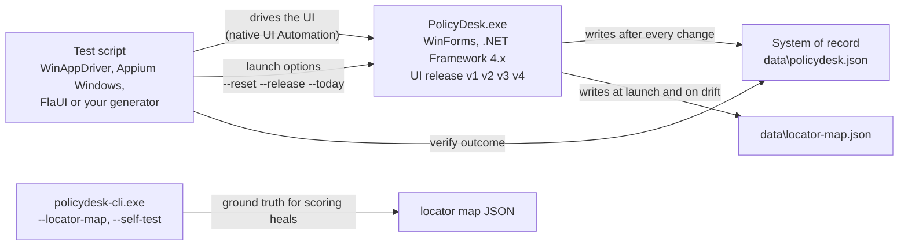
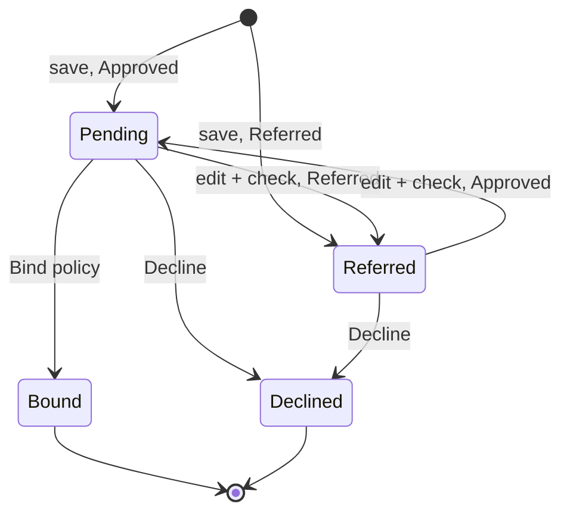

# Harbor Mutual Policy Desk — Knowledge Base

As of 2026-11-16 · Shan Konduru · Companion files: [requirements](policy-desk-requirements.csv), [test cases](policy-desk-test-cases.csv)

## Overview

The Harbor Mutual Policy Desk is a Windows desktop application ("thick client") built as a target for desktop test automation: script generation, script execution and self-healing. Branch agents of the fictitious insurer Harbor Mutual use it to quote, underwrite, bind and decline policies. It uses no real customer data, has no server and no LLM. It lives in the `SystemsUnderTest` repository in `policy-desk/`, next to the Automation Lab (its web counterpart), the chat assistant, the claims agent and the member desk.

Every screen exercises a different kind of Windows control that a generated script must drive. Every meaningful action is written to a system of record, `data\policydesk.json`, so a test run can be checked against the record, not only against what the screen shows.

| Item | Value |
| --- | --- |
| Executable | `policy-desk\app\bin\PolicyDesk.exe` (GUI); `policy-desk\app\bin\policydesk-cli.exe` (same code as a console program, for `--self-test` and `--locator-map`) |
| Launcher | `policy-desk\start_policy_desk.bat` (builds, then starts the exe with the same options) |
| Sign-in | Any user name; password `harbor` (`--password` or `POLICYDESK_PASSWORD` change it) |
| Stack | C# 5, WinForms, .NET Framework 4.x; built by `app\build.bat` with the `csc.exe` that ships with Windows (no SDK, no Visual Studio) |
| Data | `policy-desk\data\policydesk.json` (system of record) and `policy-desk\data\locator-map.json` (this launch's locators); git-ignored |
| Fixed "today" | 2026-11-03 (`--today`, `POLICYDESK_TODAY`), so prices, dates and validation are reproducible |
| UI Automation | Use a native UIA3 client: WinAppDriver, the Appium "Windows" driver, FlaUI, Inspect.exe |
| Audience | Test engineers, TruAssure pilots, demos of desktop script generation and self-healing |



A script starts the app with launch options (the test hooks), drives it through UI Automation, and checks the outcome in `data\policydesk.json`. The console build prints the locator map of any release, which is the ground truth for scoring heals.

### Run it

1. Build: `policy-desk\app\build.bat`. It writes `app\bin\PolicyDesk.exe`, `app\bin\policydesk-cli.exe` and copies `app\releases.json` to `app\bin\releases.json` (both exes read it; without it the app stops with "Release rules not found").
2. Launch: `policy-desk\start_policy_desk.bat --reset` (it builds first; `--no-build` skips that). Every other option goes to the exe, so `start_policy_desk.bat --reset --release v3 --latency-ms 800` works. Starting `app\bin\PolicyDesk.exe` directly takes the same options.
3. The main window opens with the sign-in dialog on top. Sign in with any user name and the password `harbor`.
4. Close with File > Exit or the window's close button.
5. Built-in checks: `app\bin\policydesk-cli.exe --self-test` prints one line per check and "PASSED: 83 checks"; exit code 0 means all passed. CI runs it on `windows-latest` on every push.

## Sign-in

The sign-in dialog is modal and owned by the main window. It opens when the main window is first shown. Its title is "Sign in - Harbor Mutual Policy Desk" (v2/v3 "Harbor Mutual - Sign in", v4 "Harbor Mutual - Agent sign-in").

| Element | Control (AutomationId v1) | Behaviour |
| --- | --- | --- |
| User name: | Edit (`txtUser`) | Any non-blank text; leading and trailing spaces are trimmed. v4 label "Agent ID:" |
| Password: | Edit, password (`txtPassword`) | Must equal the password option exactly (case-sensitive). Default `harbor` |
| Office: | Drop-down list (`cboOffice`) | Boston, Portland, Providence, Hartford. Preselects the Default office from Options (Boston after a reset). v4 label "Branch:" |
| Error label | Text (`lblError`) | Red. Empty until a message is shown |
| Sign in | Button (`btnSignIn`) | The default button: Enter presses it. v2/v3 "Log in", v4 "Continue" |
| Cancel | Button (`btnCancel`) | Also Esc. Closes the dialog and the application |

| Situation | Result |
| --- | --- |
| User name empty or blank | "Enter your user name." Focus to User name. Not counted as an attempt, nothing logged |
| Wrong password (1st or 2nd time) | "Invalid user name or password." Password text selected and focused. Activity `sign_in_failed` "attempt 1 of 3" (then "attempt 2 of 3"), user = the typed user name |
| Wrong password the 3rd time | "Too many attempts. Restart Policy Desk." Sign in and Password are disabled; User name and Cancel still work. Activity `sign_in_failed` "attempt 3 of 3". Only a restart allows another try |
| Correct password | Dialog closes. Status bar: "Signed in" and "User: jdoe (Boston)". Activity `sign_in` "office Boston, release v1". Focus goes to Policyholder |
| Cancel, Esc or the close button | The application exits. No `sign_in` or `sign_out` is logged (the `launch` row is) |

## Main window

Title "Harbor Mutual Policy Desk 3.0" (v2/v3 "Policy Desk 3.1 - Harbor Mutual", v4 "Harbor Mutual Policy Desk 4.0"). Minimum size 900 × 640. From top to bottom: menu bar, toolbar, three tabs, status bar.

### Menu bar

Menu items have no AutomationId in any release; match them by Name inside the menu bar.

| Menu | Item (v1 Name) | Shortcut | Action |
| --- | --- | --- | --- |
| File | New quote | Ctrl+N | Asks to discard unsaved changes if needed, clears the form, opens the New quote tab, focuses Policyholder. Status "New quote" |
| File | Save quote | Ctrl+S | Same as the Save quote button, but always enabled (see Saving) |
| File | Export quotes... | Ctrl+E | Exports the rows currently visible in the Quotes grid (see Export) |
| File | Exit | — | Closes the app (asks to discard unsaved changes if needed), logs `sign_out` |
| Quotes | Find... | Ctrl+F | Opens the Quotes tab and focuses Find policyholder |
| Quotes | Open selected | Ctrl+O | Opens Quote details for the selected row |
| Quotes | Edit selected | — | Loads the selected quote into the form (edit mode) |
| Tools | Options... | — | Opens the Options dialog |
| Help | Product guide | F1 | Opens the Product guide |
| Help | About Policy Desk | — | Message box titled "About Policy Desk": "Harbor Mutual Policy Desk 3.0", "UI release v1, today 2026-11-03", "A sample thick client for desktop test automation." |

The About text's first line is the release's main window title: v1 "Harbor Mutual Policy Desk 3.0", v2/v3 "Policy Desk 3.1 - Harbor Mutual", v4 "Harbor Mutual Policy Desk 4.0". The message box title stays "About Policy Desk" in every release.

### Toolbar (legacy)

Four icon-only buttons (coloured dots) with no text and no AutomationId. Only their tooltips say what they do. In order from the left:

| Position | Tooltip | Same as |
| --- | --- | --- |
| 1 (green) | New quote | File > New quote |
| 2 (navy) | Save quote | File > Save quote (always enabled) |
| 3 (red) | Clear form | The Clear button |
| 4 (orange) | Export quotes | File > Export quotes... |

### Status bar

The status bar (`statusMain`) holds four texts with no AutomationId. Each one's Name is its current text, so find them by position in the StatusBar.

| Position | Content |
| --- | --- |
| 1 | The last status message, e.g. "Signed in", "Quote 1006 saved (Pending)". Empty before sign-in |
| 2 | Total number of quotes, e.g. "5 quotes" (not the filtered count) |
| 3 | "UI v1", or "UI v1, drift 10s" with live drift |
| 4 | "Not signed in", then "User: jdoe (Boston)" |

### Tabs

Three tabs: New quote, Quotes (v2–v4 "Quote list"), Activity (v2–v4 "Audit log"). In UI Automation each tab header is a TabItem with that Name and no AutomationId; the tab page is a Pane with an AutomationId (`tabQuote`, `tabQuotes`, `tabActivity`) and the same Name, present only while its tab is selected. In edit mode the first tab is renamed "Edit quote 1004" (v2/v3 "Change quote 1004", v4 "Amend quote 1004").

### Unsaved changes

The form is "dirty" after any change to a field, the Notes box included, since it was last cleared, loaded or saved. When it is dirty and Options > "Ask before discarding unsaved changes" is ticked (the default), Clear, New quote, Edit selected, File > Exit and closing the window first show a message box "Discard unsaved changes?" (title "Policy Desk", Yes / No, No is the default). No cancels the action; Yes continues. With the option off, or a clean form, there is no question.

## New quote tab

The New quote tab prices and underwrites a new quote, then saves it. The same form edits an existing quote.

### Fields

| Group | Label (UIA Name) | Control (AutomationId v1) | Values and default |
| --- | --- | --- | --- |
| Policyholder | Policyholder: | Edit (`txtPolicyholder`) | Free text; required; at most 60 characters after trimming (the box itself has no length limit) |
| Policyholder | Customer type: | Drop-down list (`cboCustomerType`) | Individual (default), Business |
| Policyholder | Email: | Edit (`txtEmail`) | Optional when a phone is given |
| Policyholder | Phone: | Masked edit (`mtbPhone`), mask `(000) 000-0000` | Type digits only; stored as digits (`6175550142`) |
| Coverage | Product: | Drop-down list (`cboProduct`) | Auto (default), Home, Renters, Umbrella |
| Coverage | Coverage: | Drop-down list (`cboCoverage`) | Basic, Standard (default), Premium |
| Coverage | Deductible: | Drop-down list (`cboDeductible`) | 250, 500 (default), 1000 |
| Coverage | Start date: | Date picker (`dtpStart`), format yyyy-MM-dd | Default today + 7 (2026-11-10). In UI Automation it is a Pane whose Name is the shown date, not "Start date:" |
| Coverage | Roadside assistance (+45.00) | Check box (`chkRoadside`) | Unticked. Enabled only when Product is Auto; choosing another product unticks and disables it |
| Coverage | Multi-policy discount (-10%) | Check box (`chkMultiPolicy`) | Unticked |
| Coverage | Pay annually / Pay monthly (+3%) | Radio buttons (`rbAnnual`, `rbMonthly`) | The Default payment plan from Options (Pay annually after a reset) |
| (none) | (none) | Multi-line Edit, no AutomationId, no label (legacy Notes box) | Top right of the tab. Saved with the quote. Changing it marks the form dirty; it does not reset the underwriting check or the shown premium |

Read-only outputs on the right:

| Element | AutomationId v1 | Content |
| --- | --- | --- |
| Premium | `lblPremium` | "Premium: 600.00 a year" (bold, navy) |
| Installment | `lblInstallment` | "Paid annually", or "Monthly: 12 x 51.50 (618.00 a year)" |
| Underwriting | `lblUnderwriting` | "Underwriting: not checked", "Underwriting: checking...", "Underwriting: Approved" (green) or "Underwriting: Referred - \<reason>" (orange) |
| Progress bar | `prgUnderwriting` | Marquee bar, visible only while a check runs |
| Errors | `lblErrors` | Red; one validation message per line |
| Premium chart | `pnlChart` | Hand-drawn bars "Premium by product" (sum of the premiums of all non-Declined quotes per product). UI Automation sees an empty Pane. Hidden when Options > "Show the premium chart" is off |

Buttons below the form: **Calculate** (`btnCalculate`), **Check underwriting** (`btnCheck`), **Save quote** (`btnSave`, disabled until a check finishes), **Clear** (`btnClear`).

### Calculate

**Calculate** prices the current inputs without validating them and fills the Premium and Installment texts. The form is also priced when it is cleared, loaded for editing, and when a check starts. Changing any field other than Notes clears the shown price: the Premium text reads "Premium: not calculated" and the Installment text is empty until Calculate or Check underwriting is pressed again.

### Pricing

```latex
\text{premium} = \text{round}(\text{round}(\text{round}(\text{round}(\text{base} \times \text{coverage}) \times \text{deductible}) \times 1.15_{\text{Business}}) \times 0.90_{\text{multi-policy}}) + 45.00_{\text{Roadside, Auto}}
```

| Factor | Values |
| --- | --- |
| Base premium (a year) | Auto 480.00, Home 920.00, Renters 180.00, Umbrella 310.00 |
| Coverage | Basic × 1.00, Standard × 1.25, Premium × 1.60 |
| Deductible | 250 × 1.10, 500 × 1.00, 1000 × 0.90 |
| Business customer | × 1.15 (Individual: no change) |
| Multi-policy discount | × 0.90 when ticked |
| Roadside assistance | + 45.00, Auto only (a stored Roadside flag on another product adds nothing) |
| Rounding | To cents after every multiplication, half away from zero |
| Monthly installment | round(premium × 1.03 / 12); plan total = installment × 12 |

Money is shown as `#,##0.00` (e.g. 1,190.25). The JSON file and the CSV export write `0.00` without a thousands separator (1190.25).

Worked examples (from the built-in self-test and the seed data):

| Inputs | Premium | Monthly | Underwriting |
| --- | --- | --- | --- |
| Auto, Standard, 500, Individual | 600.00 | 12 x 51.50 (618.00 a year) | Approved |
| Auto, Standard, 500, Roadside | 645.00 | 12 x 55.36 (664.32 a year) | Approved |
| Auto, Standard, 500, Multi-policy | 540.00 | 12 x 46.35 (556.20 a year) | Approved |
| Renters, Basic, 250 | 198.00 | 12 x 17.00 (204.00 a year) | Approved |
| Umbrella, Standard, 500 | 387.50 | 12 x 33.26 (399.12 a year) | Depends on the policyholder |
| Home, Standard, 1000, Business | 1,190.25 | 12 x 102.16 (1,225.92 a year) | Approved |
| Home, Premium, 500 | 1,472.00 | 12 x 126.35 (1,516.20 a year) | Approved (highest premium under the threshold with Individual, no discount) |
| Home, Premium, 250, Multi-policy | 1,457.28 | 12 x 125.08 (1,500.96 a year) | Approved: the plan total is over 1,500.00, but the rule looks at the premium |
| Home, Premium, 500, Business, Multi-policy | 1,523.52 | 12 x 130.77 (1,569.24 a year) | Referred (lowest premium over the threshold) |
| Home, Premium, 250 | 1,619.20 | 12 x 138.98 (1,667.76 a year) | Referred |
| Auto, Premium, 250, Business, Multi-policy, Roadside | 919.37 | 12 x 78.91 (946.92 a year) | Approved |

Stacked example step by step: 480.00 × 1.60 = 768.00 → × 1.10 = 844.80 → × 1.15 = 971.52 → × 0.90 = 874.368 → 874.37 → + 45.00 = **919.37**. Monthly: 919.37 × 1.03 / 12 = 78.9126 → **78.91**, × 12 = 946.92.

No combination prices at exactly 1,500.00; the closest are 1,472.00 (Approved) and 1,523.52 (Referred).

### Validation

Validation runs when **Check underwriting** or **Save** is pressed (Calculate does not validate). Each failing field gets a red error icon (ErrorProvider) and its message; all messages appear in `lblErrors`, one per line, in this order; the status bar reads "Fix N field(s)". No check starts while there are errors.

| Field | Rule | Message |
| --- | --- | --- |
| Policyholder | Required after trimming | Policyholder is required. |
| Policyholder | At most 60 characters after trimming (60 passes, 61 fails) | Policyholder must be at most 60 characters. |
| Email / Phone | At least one of them | Enter an email address or a phone number. (icon on Email) |
| Email | If given: `x@y.z` shape, no spaces, one @ | Enter a valid email address. |
| Phone | If given: exactly 10 digits | Enter a 10-digit phone number. |
| Start date | Not before today (2026-11-03 passes, 2026-11-02 fails) | Start date cannot be in the past. |
| Start date | At most today + 60 (2027-01-02 passes, 2027-01-03 fails) | Start date must be within 60 days. |

The date picker has no minimum or maximum, so out-of-range dates can be chosen and are caught by validation.

### Check underwriting (asynchronous)

1. **Check underwriting** validates. On errors it stops there.
2. Otherwise it prices the form (Calculate), disables itself, shows the progress bar, sets the label to "Underwriting: checking..." and the status to "Checking underwriting...".
3. After `--latency-ms` (default 800 ms; 0 = at once) the result appears: the progress bar hides, Check underwriting and Save quote are enabled, the label reads "Underwriting: Approved" or "Underwriting: Referred - \<reason>", and the status "Underwriting approved" or "Underwriting referred". Activity `underwriting_checked`, e.g. "Auto 600.00: Approved".
4. Any change to a field other than Notes (while checking or after) resets the check: label "Underwriting: not checked", progress bar hidden, Save quote disabled, Premium text "Premium: not calculated" and Installment text empty. A result that arrives after such a change is dropped and nothing is logged.

Underwriting rules (the first that applies wins):

| Rule | Decision | Reason text |
| --- | --- | --- |
| Product Umbrella and no **Bound** Auto or Home quote for the same policyholder (name compared ignoring case and outer spaces) | Referred | Umbrella needs a bound Auto or Home policy for this policyholder. |
| Premium over 1,500.00 | Referred | Premium over 1,500.00 needs an underwriter. |
| Otherwise | Approved | Within the desk's authority. |

From the seed, Umbrella is Approved for "Dana Whitfield" (bound Auto 1001) and Referred for "Marcus Lee". When a quote is edited, its own record is left out of the Umbrella check.

### Saving

- **Save quote** is disabled until a check finishes for the current inputs. File > Save quote (Ctrl+S) and toolbar button 2 are always enabled and run the same steps:
  1. Opens the New quote tab.
  2. Policyholder empty: shows the validation errors and a message box "Policyholder is required." (title "Policy Desk"); focus to Policyholder.
  3. Other validation errors: shown as above; no message box.
  4. No finished check for the current inputs: message box "Check underwriting before saving." (title "Policy Desk").
  5. Otherwise saves. The status is set again by the store: Approved → **Pending**, Referred → **Referred**.
- A new quote gets the next number (1006 after a reset), `created_by` = the signed-in user, `office` = the office chosen at sign-in, `created` and `updated` = today. Activity `quote_saved` "1006 Auto 600.00 Pending".
- After saving, the form is cleared, the grid and the count refresh ("6 quotes"), and the status reads "Quote 1006 saved (Pending)".

### Clear

**Clear** (and toolbar button 3) asks to discard unsaved changes if needed, then resets the form to its defaults, leaves edit mode and shows "Form cleared". The defaults: empty texts, Individual, Auto, Standard, 500, start today + 7, Roadside and Multi-policy unticked, payment plan from Options, "Underwriting: not checked", no errors, Premium "Premium: 600.00 a year" and "Paid annually" (or "Monthly: 12 x 51.50 (618.00 a year)" when the default plan is monthly).

### Edit mode

Edit selected (Quotes menu, the Edit quote button, or the grid's context menu) loads a **Pending** or **Referred** quote into the form. A Bound or Declined quote gives "Only Pending or Referred quotes can be edited." (message box, title "Policy Desk").

- The first tab reads "Edit quote 1004", the Save button "Update quote" (v2–v4 "Save changes"), and the status "Editing quote 1004".
- The premium is recalculated; the underwriting label is "Underwriting: not checked". A check is needed before saving, as for a new quote.
- Saving keeps the number, recalculates price, status and underwriting text, sets `updated` = today, and logs `quote_updated` "1004 Auto 600.00 Pending". The status reads "Quote 1004 updated (Pending)". `next_quote` does not change.
- Clear or New quote leaves edit mode.

## Quotes tab

The Quotes tab lists every quote in a grid with a filter, a status filter and buttons.

| Element | Control (AutomationId v1) | Behaviour |
| --- | --- | --- |
| Find policyholder: | Edit (`txtFilter`) | Case-insensitive substring of the policyholder. Enter applies the filter. v4 label "Search insured:" |
| Status: | Drop-down list (`cboStatusFilter`) | All (default), Pending, Referred, Bound, Declined. Choosing a value does nothing until Find or Enter |
| Find | Button (`btnFind`) | Applies both filters (AND). Status "N quote(s) match". v2/v3 "Search", v4 link "Go" |
| Open quote | Button (`btnOpenQuote`) | Quote details for the selected row. v2/v3 "View", v4 link "Details" |
| Edit quote | Button (`btnEditQuote`) | Edit mode for the selected row. v2/v3 "Change quote", v4 link "Amend quote" |
| Export... | Button (`btnExport`) | Export the visible rows to CSV. v2/v3 "Export to CSV...", v4 "Download CSV..." |
| Grid | Table (`dgvQuotes`) | Read-only, one row selected at a time, no row headers |

Grid columns: Quote, Policyholder (v4 "Insured"), Product, Coverage, Premium (v2–v4 "Annual premium"; right-aligned, `#,##0.00`), Plan ("Annual" or "12 x 102.16"), Start (v2–v4 "Effective"), Status. Clicking a header sorts by that column (the standard grid behaviour); sorting is not recorded anywhere.

- Double-clicking a row opens Quote details.
- Right-clicking a row selects it and opens a context menu (`ctxQuotes`): **Open**, **Edit**, **Copy quote number** (v2/v3 View, Change; v4 Details, Amend). Copy puts the number on the clipboard ("1002") and shows "Copied 1002".
- Find (or Enter in Find policyholder) selects the first visible matching row, so Open quote or Edit quote straight after Find acts on the first match. When nothing matches, no row is selected. Open, Edit or Copy with no visible selected row gives "Select a quote first." (message box, title "Policy Desk") and switches to the Quotes tab.
- The filter stays in force when the grid refreshes (after a save, bind or decline). The count in the status bar is always the total.

### Seed data (after `--reset`, today 2026-11-03)

| Quote | Policyholder | Type | Contact | Product, coverage, deductible | Start | Extras, plan | Premium | Plan column | Status | Created, by, office |
| --- | --- | --- | --- | --- | --- | --- | --- | --- | --- | --- |
| 1001 | Dana Whitfield | Individual | dana.whitfield@example.com, 6175550142 | Auto, Standard, 500 | 2026-10-29 | Roadside, Annual | 645.00 | Annual | Bound (HMP-1001) | 2026-10-14, jmorgan, Boston |
| 1002 | Northwind Traders | Business | ops@northwind.example | Home, Standard, 1000 | 2026-11-17 | Monthly | 1,190.25 | 12 x 102.16 | Pending | 2026-10-28, jmorgan, Boston |
| 1003 | Priya Raman | Individual | priya.raman@example.com, 4015550199 | Renters, Basic, 250 | 2026-11-13 | Annual | 198.00 | Annual | Pending | 2026-10-31, akim, Providence |
| 1004 | Marcus Lee | Individual | 8605550123 (no email) | Umbrella, Standard, 500 | 2026-11-24 | Annual | 387.50 | Annual | Referred | 2026-11-01, akim, Hartford |
| 1005 | Elena Ruiz | Individual | elena.ruiz@example.com | Home, Premium, 250 | 2026-12-03 | Multi-policy, Monthly | 1,457.28 | 12 x 125.08 | Declined ("Price too high") | 2026-11-02, jmorgan, Portland |

The next quote is 1006. Underwriting texts: 1004 "Umbrella needs a bound Auto or Home policy for this policyholder."; the others "Within the desk's authority.". Seed dates move with `--today`: starts are today −5, +14, +10, +21, +30; created today −20, −6, −3, −2, −1.

Useful filter facts: "lee" → 1 (1004); "RUIZ" → 1 (1005); "e" → 4 (all but Priya Raman); "zzz" → 0; Status Pending → 2 (1002, 1003); "priya" + Pending → 1.

### Export

Export (the Export... button, File > Export quotes... / Ctrl+E, toolbar button 4) writes the rows **currently visible in the grid**, in grid order, whatever tab is open.

- A standard Windows Save File dialog opens, titled "Export quotes", file type "CSV files (*.csv)", file name `quotes-2026-11-03.csv` (from today), folder `--export-dir` or Documents. Replacing an existing file asks for confirmation (Windows' own prompt).
- Cancel writes nothing and logs nothing.
- Save writes UTF-8 (no BOM), CRLF line ends, header `Quote,Policyholder,Customer type,Product,Coverage,Deductible,Start date,Premium,Payment plan,Plan total,Status`, then one line per row. Premium and plan total are written as `1190.25` (no thousands separator). A cell with a comma, quote or line break is wrapped in quotes, with quotes doubled: `Smith, "Jo"` → `"Smith, ""Jo"""`.
- Activity `quotes_exported` "5 to quotes-2026-11-03.csv"; status "Exported 5 quote(s) to quotes-2026-11-03.csv".

Seed export (unfiltered):

```text
Quote,Policyholder,Customer type,Product,Coverage,Deductible,Start date,Premium,Payment plan,Plan total,Status
1001,Dana Whitfield,Individual,Auto,Standard,500,2026-10-29,645.00,Annual,645.00,Bound
1002,Northwind Traders,Business,Home,Standard,1000,2026-11-17,1190.25,Monthly,1225.92,Pending
1003,Priya Raman,Individual,Renters,Basic,250,2026-11-13,198.00,Annual,198.00,Pending
1004,Marcus Lee,Individual,Umbrella,Standard,500,2026-11-24,387.50,Annual,387.50,Referred
1005,Elena Ruiz,Individual,Home,Premium,250,2026-12-03,1457.28,Monthly,1500.96,Declined
```

## Quote details dialog

Open quote (button, menu, context menu, Ctrl+O, or a double-click) shows a modal dialog titled "Quote 1002" (same in every release). Ten read-only Edit boxes, named by their labels:

| Label | AutomationId v1 | Example (1002) |
| --- | --- | --- |
| Quote: | `txtDetailQuote` | 1002 |
| Policyholder: | `txtDetailPolicyholder` | Northwind Traders |
| Product: | `txtDetailProduct` | Home, Standard |
| Deductible: | `txtDetailDeductible` | 1000 |
| Start date: | `txtDetailStart` | 2026-11-17 |
| Premium: | `txtDetailPremium` | 1,190.25 |
| Payment plan: | `txtDetailPlan` | 12 x 102.16 (or "Annual") |
| Status: | `txtDetailStatus` | Pending |
| Policy number: | `txtDetailPolicy` | (empty; HMP-1002 once bound) |
| Underwriting: | `txtDetailNote` | Within the desk's authority. (Declined quotes: "Declined: Price too high") |

These labels are not reworded in any release.

| Button (AutomationId v1) | Enabled for | Action |
| --- | --- | --- |
| Bind policy (`btnBind`; v2–v4 "Issue policy") | Pending only | Status Bound, policy number `HMP-<quote>`, `updated` = today. Activity `quote_bound` "1002 as HMP-1002". The dialog closes; status "Quote 1002 bound as policy HMP-1002"; grid refreshes |
| Decline... (`btnDecline`; v2–v4 "Reject...") | Pending and Referred | Opens the Decline dialog on top |
| Close (`btnClose`) | Always (also Esc) | Closes without changes |

Binding does not run the underwriting check again.

### Decline dialog (a modal on top of a modal)

Title "Decline quote" (v2–v4 "Reject quote").

| Element | AutomationId v1 | Behaviour |
| --- | --- | --- |
| Reason: | `cboReason` | Customer withdrew (default), Price too high, Underwriting decision, Other |
| Note: | `txtDeclineNote` | Used only with Other |
| Error label | `lblDeclineError` | "Enter a note for Other." when Other has a blank note; focus to Note; dialog stays open |
| Decline quote | `btnConfirmDecline` (v2–v4 "Reject quote") | Confirms |
| Cancel | `btnCancelDecline` (also Esc) | Back to Quote details, nothing changed |

On confirm: status Declined, `decline_reason` = "\<reason>: \<trimmed note>" when a note is given (for any reason, e.g. "Price too high: competitor quote"), else just "\<reason>" (Other always has a note), `updated` = today. Activity `quote_declined` "1004: Price too high". Both dialogs close; status "Quote 1004 declined". Quote details of a declined quote show "Declined: \<reason>" under Underwriting.

Status changes:



## Options dialog

Tools > Options... opens "Options" (v2–v4 "Preferences").

| Element | AutomationId v1 | Default | Effect |
| --- | --- | --- | --- |
| Default office: | `cboDefaultOffice` | Boston | Preselected in the sign-in dialog at the next launch |
| Default payment plan (group) | `grpDefaultPlan` | — | — |
| Pay annually / Pay monthly (+3%) | `rbDefaultAnnual`, `rbDefaultMonthly` | Pay annually | Plan selected when the form is next cleared (Clear, New quote, after a save) |
| Ask before discarding unsaved changes | `chkConfirmDiscard` | Ticked | Turns the "Discard unsaved changes?" question on or off |
| Show the premium chart | `chkShowChart` | Ticked | Shows or hides the chart at once |
| OK | `btnOptionsOk` (v2–v4 "Save"; default button) | — | Saves to `settings` in policydesk.json, logs `settings_saved` "office Boston, plan Annual, confirm on, chart on" (even when nothing changed), status "Options saved" |
| Cancel | `btnOptionsCancel` (also Esc) | — | Discards |

## Product guide

Help > Product guide (F1) opens "Product guide": a tree (`tvProducts`) and a read-only text box (`txtGuideDetail`), plus **Close** (`btnGuideClose`, also Esc). The tree has four product nodes, each with three coverage children named "\<Coverage> - \<price>" (Individual, deductible 500, no extras):

| Product | Basic | Standard | Premium |
| --- | --- | --- | --- |
| Auto | 480.00 | 600.00 | 768.00 |
| Home | 920.00 | 1,150.00 | 1,472.00 |
| Renters | 180.00 | 225.00 | 288.00 |
| Umbrella | 310.00 | 387.50 | 496.00 |

Selecting a product shows its description, e.g. Auto: "Car insurance for private vehicles. Roadside assistance can be added for 45.00 a year." (Home: "Buildings and contents cover for owner-occupied homes."; Renters: "Contents and liability cover for tenants."; Umbrella: "Extra liability cover on top of a bound Auto or Home policy for the same policyholder."). Selecting a coverage shows e.g. "Auto, Standard cover: 600.00 a year for an individual with a 500 deductible, before discounts and extras."

## Activity tab

The Activity tab (v2–v4 "Audit log") shows the activity log in a list view (`lvActivity`) with columns #, Date, User, Event, Details, **newest first**. It refreshes itself after every change; **Refresh** (`btnRefreshActivity`; v2–v4 "Reload", a link in v4) reloads it on demand. Event is the activity kind.

## System of record: data\policydesk.json

The store lives in the `--data` folder (default `policy-desk\data`). It is written after every change through a temporary file that replaces the old one, so a reader never sees half a file. The file is created with the seed when it is missing; `--reset` overwrites it with the seed.

```json
{
  "schema": 1,
  "today": "2026-11-03",
  "next_quote": 1006,
  "settings": {"default_office": "Boston", "default_plan": "Annual", "confirm_discard": true, "show_chart": true},
  "quotes": [ { "number": 1001, "status": "Bound", "...": "..." } ],
  "activity": [ {"seq": 1, "date": "2026-11-03", "user": "system", "kind": "reset", "detail": "Seed data loaded: 5 quotes"} ]
}
```

Quote fields, in order: `number`, `status` (Pending, Referred, Bound, Declined), `policyholder`, `customer_type`, `email`, `phone` (digits), `product`, `coverage`, `deductible` (number), `start_date`, `roadside`, `multi_policy`, `payment_plan` (Annual, Monthly), `notes`, `premium`, `installment`, `plan_total` (numbers with two decimals), `underwriting` (the reason text), `policy_number`, `decline_reason`, `created_by`, `office`, `created`, `updated`. Dates are `yyyy-MM-dd`. Stored prices are not recalculated when the file is loaded.

Activity rows have `seq` (1, 2, 3… from a reset), `date` (always the fixed today, no time), `user`, `kind`, `detail`.

| Kind | User | Detail (example) | Written when |
| --- | --- | --- | --- |
| `reset` | system | Seed data loaded: 5 quotes | `--reset`, or first launch with no file |
| `launch` | system | release v1, today 2026-11-03, reset, drift 10s | Every launch (", reset" and ", drift Ns" only when used) |
| `sign_in_failed` | the typed user name | attempt 1 of 3 | Wrong password |
| `sign_in` | user | office Boston, release v1 | Successful sign-in |
| `sign_out` | user | (empty) | File > Exit or closing the main window after sign-in |
| `underwriting_checked` | user | Auto 600.00: Approved | A check finishes (not when it is dropped) |
| `quote_saved` | user | 1006 Auto 600.00 Pending | New quote saved |
| `quote_updated` | user | 1004 Auto 600.00 Pending | Edited quote saved |
| `quote_bound` | user | 1002 as HMP-1002 | Bind policy |
| `quote_declined` | user | 1004: Other: duplicate request | Decline confirmed |
| `quotes_exported` | user | 5 to quotes-2026-11-03.csv | Export saved |
| `settings_saved` | user | office Portland, plan Monthly, confirm on, chart off | Options OK |
| `drift` | system | generation 1 | Each live-drift rename |

After `--reset` and a sign-in the log holds exactly: 1 `reset`, 2 `launch`, 3 `sign_in`.

### Verifying a run

| To prove | Check in policydesk.json |
| --- | --- |
| A quote was saved | `quotes[]` has the number with every field and price; `next_quote` advanced; activity `quote_saved` |
| A quote was edited | Same number, new fields and price, `updated` = today; `next_quote` unchanged; activity `quote_updated` |
| A quote was bound | `status` Bound, `policy_number` HMP-\<number>; activity `quote_bound` |
| A quote was declined | `status` Declined, `decline_reason`; activity `quote_declined` |
| Options were saved | `settings.*`; activity `settings_saved` |
| A check ran | activity `underwriting_checked` with product, premium and decision |
| An export ran | The CSV file itself, and activity `quotes_exported` |

## Test hooks: launch options

Every option has an environment variable; the command line wins. An empty variable is ignored.

| Option | Variable | Default | Purpose |
| --- | --- | --- | --- |
| `--reset` | — | off | Start from the seed (quotes 1001–1005, default options) and a new activity log |
| `--today YYYY-MM-DD` | `POLICYDESK_TODAY` | 2026-11-03 | Fixed "today" for validation, default start date, seed dates, record dates, export file name |
| `--data DIR` | `POLICYDESK_DATA` | `policy-desk\data` | Folder for policydesk.json and locator-map.json (created if missing) |
| `--release v1…v4` | `POLICYDESK_RELEASE` | v1 | UI release (case-insensitive) |
| `--release-seed N` | `POLICYDESK_RELEASE_SEED` | random | 0 or more: makes v3/v4 (and drift) random names repeatable |
| `--drift N` | `POLICYDESK_DRIFT_SECONDS` | 0 | Rename every control every N seconds from launch, the sign-in dialog included (0 = off, else 2–300) |
| `--latency-ms N` | `POLICYDESK_LATENCY_MS` | 800 | Duration of the underwriting check (0–30000) |
| `--password TEXT` | `POLICYDESK_PASSWORD` | harbor | Sign-in password; must not be empty |
| `--defects a,b` | `POLICYDESK_DEFECTS` | (none) | Test runs only: planted defects (see "Planted defects and the baseline suite") |
| `--export-dir DIR` | `POLICYDESK_EXPORT_DIR` | Documents | Folder the Export dialog opens in |
| `--locator-map R` | — | — | Write release R's locator map as JSON and exit (with `--out FILE`, else to the console) |
| `--out FILE` | — | — | Output file for `--locator-map` or `--self-test`; the console build prints "Wrote \<path>" |
| `--self-test` | — | — | Run the built-in checks and exit (0 = all passed, 1 = a failure) |
| `--help`, `-h`, `/?` | — | — | Print the options and exit 0 |

Invalid options stop the app with exit code 2. The console build prints the message and the option list to stderr; `PolicyDesk.exe` shows them in a message box titled "Policy Desk". Messages:

| Input | Message |
| --- | --- |
| `--release v9` | Release must be v1, v2, v3 or v4, not "v9". |
| `--drift 1` | --drift must be 0 (off) or 2-300 seconds. |
| `POLICYDESK_DRIFT_SECONDS=1` | POLICYDESK_DRIFT_SECONDS must be 0 (off) or 2-300 seconds. (other bad values: "POLICYDESK_DRIFT_SECONDS must be a whole number from 0 to 300, not ...") |
| `--drift 301` | --drift must be a whole number from 0 to 300, not "301". |
| `--latency-ms 30001` | --latency-ms must be a whole number from 0 to 30000, not "30001". |
| `--release-seed -1` | --release-seed must be a whole number from 0 to 2147483647, not "-1". |
| `--today 03/11/2026` | Today must be a date like 2026-11-03, not "03/11/2026". |
| `--bogus` | Unknown option: --bogus |
| `--latency-ms` (no value) | --latency-ms needs a value. |
| `--password ""` | The password must not be empty. |

Use `policydesk-cli.exe` for `--self-test`, `--locator-map` and `--help` so the output reaches the console and the exit code can be awaited. Do not pass GUI options to the console build expecting a console-only run: without `--self-test`, `--locator-map` or `--help` it opens the GUI.

## Planted defects and the baseline suite

`--defects a,b` (or `POLICYDESK_DEFECTS`) switches on deliberate bugs for test runs. They are off by default, unknown names are refused (exit code 2), and the app never shows which are on. Each is caught by a test of the baseline suite in `tests/` (pytest + pywinauto, marked `@pytest.mark.catches("<defect>")`); `tools\defect_matrix.py` proves the clean build passes and every defect fails its test.

| Defect | Symptom a test sees |
| --- | --- |
| `multi_policy_ignored` | The screen shows 540.00 with the multi-policy discount; the `policydesk.json` premium is 600.00 |
| `monthly_truncated` | Renters, Basic, 250, monthly reads "Monthly: 12 x 16.99 (203.88 a year)" instead of 17.00 (204.00) |
| `umbrella_unchecked` | Umbrella for a new policyholder is "Underwriting: Approved" instead of Referred |
| `start_today_rejected` | A start date of 2026-11-03 (today) gives "Start date cannot be in the past." |
| `phantom_bind` | The status says "Quote 1002 bound as policy HMP-1002", but the grid and the record still say Pending |
| `no_lockout` | A third wrong password gives "Invalid user name or password." again; Sign in stays enabled |
| `grid_not_refreshed` | "Quote 1006 saved (Pending)", but the Quotes grid has no row 1006 and the count stays "5 quotes" |
| `export_drops_last` | "Exported 2 quote(s)", but the CSV holds only the first |
| `slow_underwriting` | The underwriting result takes 12 s, whatever `--latency-ms` says |
| `email_unlabeled` | The Email box's UI Automation Name is empty instead of "Email:" |

The suite uses the v1 AutomationIds, the way a recorded suite would: it passes on v1 and fails at its first locator on v2–v4. That failure is the starting point self-healing is measured from.

## UI releases, live drift and the locator map (self-healing)

The desk does not heal anything itself: it is the application whose locators break, so a framework's healing can be shown and scored. Every screen is written once, as v1, and rewritten while it is built for the selected release. The rules live only in `app\releases.json` (copied to `app\bin`), which both the screens and the locator map read. Behaviour, data, messages, message boxes and status texts never change.

| Locator | v1 Baseline | v2 Redesign | v3 Dynamic | v4 Structural |
| --- | --- | --- | --- | --- |
| AutomationId | As authored, e.g. `txtPolicyholder` | Renamed: `hmInsuredName`, windows `frmHm…` | `c` + 8 hex digits, new on every launch (repeatable with `--release-seed`) | As v3 |
| Window titles | Harbor Mutual Policy Desk 3.0; Sign in - Harbor Mutual Policy Desk | Policy Desk 3.1 - Harbor Mutual; Harbor Mutual - Sign in | As v2 | Harbor Mutual Policy Desk 4.0; Harbor Mutual - Agent sign-in |
| Button, menu, tab and column texts | As authored | Reworded (list 1) | As v2 | Reworded differently (list 2) |
| Field labels, so the Names of edits, lists, check boxes and radio buttons | As authored | Unchanged | Unchanged | Reworded (list 3) |
| Layout | As authored | Two pairs swapped: Email ↔ Phone, Coverage ↔ Deductible | As v2 | As v2, plus Pay annually ↔ Pay monthly and User name ↔ Password |
| Control types | As authored | Unchanged | Unchanged | 6 buttons become link labels |
| Messages, status texts, message boxes, dialog field labels, data | Stable | Stable | Stable | Stable |

1. **v2/v3 texts:** Sign in → Log in; Calculate → Price it; Check underwriting → Run underwriting; Save quote (button) → Save; Update quote → Save changes; Clear → Reset; Find → Search; Open quote → View; Edit quote → Change quote (also the edit-mode tab, "Change quote 1004"); Export... → Export to CSV...; Bind policy → Issue policy; Decline... → Reject...; Decline quote (window and button) → Reject quote; Refresh → Reload; Options (window) → Preferences; OK → Save. Menus: New quote → Create quote; Export quotes... → Export to CSV...; Open selected → View selected; Edit selected → Change selected; Options... → Preferences...; context menu Open → View, Edit → Change. Tabs: Quotes → Quote list; Activity → Audit log. Columns: Premium → Annual premium; Start → Effective. Unchanged: File > Save quote, Find..., Exit, Product guide, About Policy Desk, Copy quote number, New quote tab, Close, Cancel.
2. **v4 texts:** as v2 except Sign in → Continue; Calculate → Quote price; Check underwriting → Check risk; Clear → Start again; Find → Go; Open quote → Details; Edit quote → Amend quote ("Amend quote 1004"); Export... and File > Export quotes... → Download CSV...; Open selected → Details; Edit selected → Amend selected; context Open → Details, Edit → Amend; group box and column Policyholder → Insured.
3. **v4 labels:** User name: → Agent ID:; Office: → Branch:; Policyholder: → Insured name:; Customer type: → Customer is a:; Email: → Email address:; Phone: → Telephone:; Coverage: → Cover level:; Deductible: → Excess:; Start date: → Effective date: (the picker's Name is still its date); Find policyholder: → Search insured:; Roadside assistance (+45.00) → Breakdown cover (+45.00); Multi-policy discount (-10%) → Bundle discount (-10%); Pay annually → Yearly; Pay monthly (+3%) → Monthly instalments (+3%). Not reworded: Password:, Product:, Status:, the Quote details labels, the Decline and Options dialog fields.

v4 link labels: **Calculate**, **Clear**, **Find**, **Open quote**, **Edit quote** and **Refresh** (Activity). UI Automation shows a Text element that carries the AutomationId, with a Hyperlink child (Invoke pattern, no AutomationId) that is what to click.

Swaps move controls only: tab order and the Names that come from labels stay correct, so name-based locators survive while position-based healing picks the wrong field. In v2–v4 typing an email "into the second box" puts it into Phone; the masked box rejects letters and validation then fails, or `policydesk.json` shows the values in the wrong fields.

### Which release for which kind of healing

| Kind of healing | Use | Why |
| --- | --- | --- |
| Design-time: the tool repairs the saved script once | v2 | Renames are fixed, so a repaired locator keeps working on every later launch |
| Run-time: the tool finds the element live, script unchanged | v3 | AutomationIds change on every launch; `--release-seed` makes a failing run repeatable |
| Run-time, hardest | v4 | Labels, texts, positions and control types change too |
| Run-time, mid-session | `--drift N` | Every AutomationId changes again every N seconds while the script runs, from launch (sign-in included) |

### Choosing a release

1. `--release v2` (or `POLICYDESK_RELEASE=v2`) when launching. There is no switch inside the app.
2. The status bar shows "UI v2"; the `launch` and `sign_in` activity rows name the release; the About box says "Policy Desk 3.1 - Harbor Mutual" and "UI release v2".
3. `--release-seed N` fixes v3/v4 random AutomationIds: the same seed gives the same ids on every launch and in `--locator-map`.

### Live drift

- `--drift N` (2–300 s) starts a timer when the main window is shown, before the sign-in dialog opens, so the sign-in dialog is renamed too and `drift` rows can appear before `sign_in`. Every N seconds every named control in every open window gets a new random AutomationId (`c` + 8 hex), the first drift included on v1 and v2. Texts and layout do not change. Legacy controls stay unnamed.
- Signals: the status bar reads "UI v1, drift 10s"; each drift logs `drift` "generation N" (user system) and rewrites `data\locator-map.json` with `"dynamic": true` and `"drift_generation": N`.
- Dialogs opened later get the current generation's names.

### Locator map (scoring heals)

- `app\bin\policydesk-cli.exe --locator-map v2 [--out map.json]` writes release v2's map and exits; add `--release-seed N` for v3/v4 to get the ids a launch with the same seed will use.
- The running app writes this launch's map to `data\locator-map.json` at launch and after every drift. For v3/v4 without a seed this file is the only place the actual ids are known.
- Top level: `release`, `description`, `scheme` (authored, renamed, random), `dynamic` (true when ids cannot be known before launch: v3/v4 without a seed, or after a drift), `drift_generation`, `release_seed`, `elements`.
- `elements`: 108 entries over six windows (LoginForm, MainForm, QuoteDetailsForm, DeclineForm, OptionsForm, ProductGuideForm), each with `key` (the v1 name), `window`, `automation_id` ("" for menu items, status texts and legacy controls), `control_type` (as UI Automation reports it), `name` (the expected UIA Name), `legacy`, and when relevant `note` (how to reach it) and `swapped_with`.
- The map is ground truth for scoring. A framework under test must not read it to heal.

### Locators that survive

| Strategy | v1 | v2 | v3 | v4 | Live drift |
| --- | --- | --- | --- | --- | --- |
| AutomationId, absolute XPath | Yes | No | No | No | No |
| ControlType + Name of a field (from its label) | Yes | Yes | Yes | No: needs synonym or semantic matching | Yes |
| ControlType + Name of a button, menu item or tab | Yes | With v2 wording | With v2 wording | No: wording and control type change | Yes, at that release's wording |
| Position in the window | Yes | No for swapped fields | No for swapped fields | No | Yes |
| Messages, status texts, message boxes, read-only detail labels | Yes | Yes | Yes | Yes | Yes |

## Desktop automation notes and traps

- **Use native UIA3.** WinAppDriver, the Appium "Windows" driver, FlaUI (UIA3) and Inspect.exe see WinForms control names as AutomationIds. The managed `System.Windows.Automation` client (used by the Appium NovaWindows driver) reports WinForms AutomationIds as window handles (numbers that change every launch), reports most types as Pane, and sees the menu, toolbar and status bar as opaque.
- **Modal dialogs block Invoke.** Invoking a button that opens a modal dialog (Open quote, Decline..., Export..., Edit on a Bound quote, Options, About, any action that ends in a message box) through the UIA Invoke pattern does not return until the dialog closes. Click with the mouse, send the keyboard shortcut, or post the Invoke asynchronously, then wait for the dialog window.
- **Message boxes** are standard Win32 dialogs (class `#32770`) titled "Policy Desk" (the About box: "About Policy Desk"). The message is a Text element; the buttons are "OK", or "Yes" / "No".
- **The Save File dialog** is the Windows common dialog titled "Export quotes": type the full path into "File name:" and press Save (or Enter).
- **Dialogs are children of the main window** in the UI Automation tree (sign-in, Quote details, Decline, Options, Product guide, message boxes, Save File). Search under the main window, or from the desktop by process.
- **Legacy controls.** The four toolbar buttons have no AutomationId and no reliable Name: reach them by index inside the ToolBar (1 New quote, 2 Save quote, 3 Clear form, 4 Export quotes) or by image. The Notes box has no AutomationId and no label: it is the only Edit that is a direct child of the New quote page (the others sit inside the Policyholder group); position: top right. The premium chart is an empty Pane (`pnlChart`): check it by image.
- **Date picker:** a Pane whose Name is the shown date (yyyy-MM-dd), not "Start date:". Click it, type the year, Right, the month, Right, the day, then Tab; check the Pane's Name.
- **Drop-down lists** fire their change events only for user input. Choose with the mouse (expand, click the item) or the keyboard (focus, type the first letters or use arrows), not by setting the selection through UI Automation, or Roadside and the underwriting reset will not react.
- **Masked phone box:** type digits only; its Value shows the mask, e.g. "(617) 555-0142".
- **Tab pages vs TabItems.** Click the TabItem (Name "Quotes", no AutomationId). The tab page is a Pane with the AutomationId and exists in the tree only while its tab is selected, so its controls are found only then. In edit mode the first TabItem is "Edit quote N".
- **Menu items and status texts have no AutomationId** in any release. Match menu items by Name under the menu bar, status texts by position under the StatusBar.
- **Empty labels borrow the previous label's Name.** An empty error label (`lblError`, `lblErrors`, `lblDeclineError`) can report the text of the label before it. Read a message only after the action, and compare the full text.
- **Stray Name.** The menu bar and the toolbar report a Name "Status:" (borrowed from a label). Do not use it.
- **v4 link labels:** the Text element has the AutomationId; click its Hyperlink child.
- **Waits:** wait for states, not time. The underwriting check takes `--latency-ms` (800 ms by default, up to 30 s): wait until `lblUnderwriting`'s Name starts with "Underwriting: Approved" or "Underwriting: Referred", or until Save quote is enabled. Wait for a dialog window to exist before using it, and for it to disappear after closing it.
- **Grid rows:** find a row by its Quote cell value (cells expose their text through the Value pattern), not by row index; hidden (filtered) rows are not shown.
- **Premium after a change:** after changing a field (not Notes) the Premium text reads "Premium: not calculated" until Calculate or Check underwriting; wait for "Premium: " followed by a digit before reading the price.

### Recommended locator per element kind

| Element kind | Locator | Notes |
| --- | --- | --- |
| Main window | Top-level window of process PolicyDesk.exe | Title changes per release |
| Dialogs | Window under the main window whose Name matches the release's title | Sign-in /Sign in\|sign-in/; details "Quote N"; Decline /Decline quote\|Reject quote/; Options /Options\|Preferences/; "Product guide"; "Export quotes"; message boxes "Policy Desk" |
| Edits, drop-down lists | ControlType + Name (label text with colon) inside the window | v4 needs the list 3 wording; v1/v2 also by AutomationId |
| Check boxes, radio buttons | ControlType + Name (own text) | v4 list 3 |
| Buttons | ControlType Button + Name (regex over the release wordings) | In v4 six are Hyperlinks inside a Text element |
| Menu items | MenuItem + Name under the menu bar, or the keyboard shortcut | No AutomationId |
| Tabs | TabItem + Name | No AutomationId; page Pane appears when selected |
| Status texts | Text children of the StatusBar by index 1–4 | Name = current text |
| Outputs (premium, underwriting, errors) | AutomationId on v1/v2; on v3/v4 the Text element whose Name starts with "Premium:", "Underwriting:" | Never a fixed position |
| Toolbar buttons | Index in the ToolBar, or image | Legacy |
| Notes | The Edit that is a direct child of the New quote page | Legacy |
| Chart | AutomationId on v1/v2; image | Opaque |

### UI Automation readiness report

`tools\uia_report.bat` prints what UI Automation clients see, in two views: native UIA3 (`tools\bin\UiaReport.exe`, as Inspect, WinAppDriver, the Appium Windows driver and FlaUI see it) and NovaWindows (`tools\uia_report_nova.ps1`, managed `System.Windows.Automation`). Options for both: `-Exe -Arguments -ProcessName -WindowTitle -WaitSeconds -MaxDepth -KeepOpen -Quiet`, and `-Csv` / `-Json` when one view is run on its own. It never clicks or types and never reads password values.

- `tools\uia_report.bat -Exe app\bin\PolicyDesk.exe -Arguments "--reset"` starts the app once per view (the sign-in dialog is open).
- `tools\uia_report.bat -ProcessName PolicyDesk` attaches to a running app, e.g. after signing in.

Each interactive control is graded good (stable AutomationId; WinForms ids that are window handles do not count), fair (Name only), poor (neither) or opaque (an empty pane with no children), with a readiness percentage. The README records v1 at 70% in the native view (46 interactive, 23 good, 18 fair, 5 poor, 1 opaque pane) and 37% in the NovaWindows view. Use the native view.

### End-to-end smoke (tools\smoke.bat)

`tools\smoke.bat [v1|v2|v3|v4]` (all four releases by default) builds the app and the tools, then runs `tools\bin\PolicyDeskSmoke.exe` (source `tools\Smoke.cs`) once per release. It drives the real app through native UIA3, the way WinAppDriver, the Appium Windows driver or FlaUI would. Each run launches `PolicyDesk.exe --reset --release <r> --release-seed 7 --latency-ms 600` with its own temporary `--data` folder, finds every control by the AutomationId that `data\locator-map.json` gives for that release, and checks outcomes in `data\policydesk.json`. Its 10 steps:

1. The app writes its locator map.
2. The sign-in dialog opens over the main window.
3. A wrong password is refused.
4. The right password signs in.
5. An Umbrella quote for a customer with a bound Auto policy is Approved after the wait.
6. Save quote stores quote 1006 as Pending.
7. The icon-only Save button (second toolbar button) reaches a message box.
8. Quote 1002 is opened from the Quotes tab and bound.
9. The activity log recorded it all.
10. Closing the window signs out.

It waits for states, never fixed sleeps; clicks anything that opens a modal dialog with the mouse; reaches the toolbar by position and v4 link labels through their Hyperlink child. It prints "PASSED (10 steps)" or "FAILED at step N: ..."; exit code 0 means every release passed. It moves the mouse and needs an unlocked, interactive desktop, so it is not run in CI (CI runs the self-test on `windows-latest`). It passed on v1, v2, v3 and v4, and is a worked example for generated scripts.

## Automation guidance and companion files

Two CSV files turn this knowledge base into a requirements baseline and an automation-ready test suite; every acceptance criterion is covered by at least one test case.

| File (in `policy-desk/docs/`) | Content | Size |
| --- | --- | --- |
| `policy-desk-requirements.csv` | 29 user stories (REQ-01 to REQ-29) in 9 epics, one row per acceptance criterion in Given/When/Then form | 138 acceptance criteria |
| `policy-desk-test-cases.csv` | Test cases traced to requirement and AC ids, with type, priority, level (UI, UI+Data, Data, CLI, UI+CLI), preconditions, data, steps, expected result, UI Automation locators, the policydesk.json check, wait strategy, releases and tags | 144 test cases: 86 happy path, 24 negative, 22 edge, 12 boundary |

Locator notation in the test cases: `Edit 'Policyholder:'` means ControlType Edit with UIA Name "Policyholder:"; `[id txtPolicyholder / hmInsuredName]` gives the v1 / v2 AutomationIds; `Button /^(Check underwriting|Run underwriting|Check risk)$/` matches the v1, v2/v3 and v4 wordings.

### Writing scripts that survive every release

1. Start each test from a known state: launch with `--reset` and an explicit `--release`, `--today` if dates matter, and `--latency-ms` set for the test (800 to see the progress bar; 0 for speed). Use `--data` with a temporary folder to keep runs apart.
2. Find the main window by process, dialogs under it by title pattern, and controls by ControlType + Name inside their window.
3. Use AutomationIds only for v1 and v2. For v3 use Names; for v4 add the v4 wordings or semantic matching, and click the Hyperlink inside a link label.
4. Open modal dialogs with a mouse click or a shortcut, never a synchronous Invoke.
5. Wait for states: the underwriting label, an enabled button, a window that appears or closes, a status text.
6. Verify outcomes in `data\policydesk.json` (quotes, settings, activity), not only on screen.
7. Score heals against `--locator-map` (with the same `--release-seed`) or `data\locator-map.json`; never let the framework read them.
